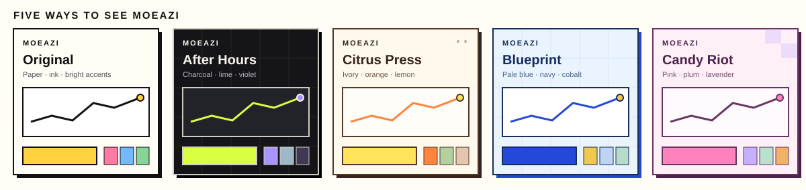
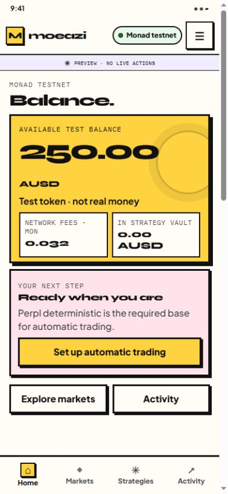
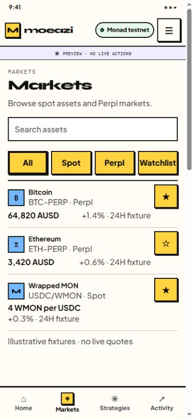
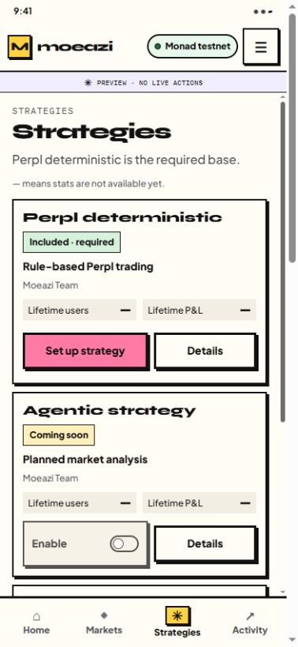
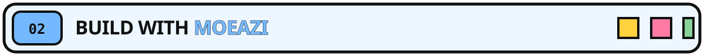
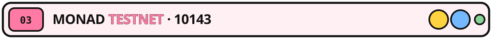

# Moeazi Monad Mobile

<p align="center">
  
</p>

**A passkey-based mobile app for exploring Monad Testnet.** Moeazi combines a Mera wallet with market discovery, reviewed wallet actions, strategy workflows, and a local backend.

> [!IMPORTANT]
> The app targets **Monad Testnet (chain 10143)**. Test AUSD, MON, and other test assets have no real-world value. Fresh local setup leaves provider keys blank and funded testnet execution gates, mainnet venues, and live execution disabled; Manual Guard and Lite Mode stay on.

<p align="center">
  
</p>

## ✨ What’s in the app

- **Sign in with Mera:** create or use a passkey, open a short-lived mobile session, and use the associated Mera wallet on Monad Testnet.
- **Home and activity:** see test-asset balances, freshness and observation details, next steps, and transaction or strategy status.
- **Markets:** browse and search Monad Spot pools and Perpl markets, keep a watchlist, open market details, and see when a route is read-only or unavailable.
- **Strategies:** inspect the required Perpl strategy and supported setup, status, history, and recovery flows. Manual Perpl accounts remain separate from autonomous strategy vaults.
- **Wallet tools:** receive to an address or QR code, request test AUSD, send supported test assets, and use available wrap, swap, and trade flows. Transaction actions show an exact review before Mera signing.
- **Two presentations:** User Mode is the default, with Home, Markets, Strategies, and Activity. Developer Mode opens the original five-tab workspace and diagnostics.

## 🎨 Choose an appearance

Settings lets you save one of five looks on this device. The preference changes the app’s presentation, not wallet or network state.



*Palette preview only; this is not a native app screenshot.*

| Appearance | Palette |
| --- | --- |
| **Original** | Paper, ink, and bright accents |
| **After Hours** | Charcoal, lime, and violet |
| **Citrus Press** | Warm ivory, orange, and lemon |
| **Blueprint** | Pale blue, navy, and cobalt |
| **Candy Riot** | Pink, plum, and lavender |

### A few screens from the prototype

These are **simulated design previews** from the local HTML prototype. Balances, quotes, and other values are fixtures; the prototype does not connect a wallet or call the network.

<table>
  <tr>
    <th scope="col">Home</th>
    <th scope="col">Markets</th>
    <th scope="col">Strategies</th>
  </tr>
  <tr>
    <td><a href="docs/user-experience/evidence/readme-prototype-home.png"></a></td>
    <td><a href="docs/user-experience/evidence/readme-prototype-markets.png"></a></td>
    <td><a href="docs/user-experience/evidence/readme-prototype-strategies.png"></a></td>
  </tr>
</table>

Explore the [interactive prototype](http://127.0.0.1:8765/user-experience/prototype.html) after starting the [local UX hub](docs/user-experience/README.md). Its [source](docs/user-experience/prototype.html) and [research notes](docs/user-experience/) are in the repository.

<p align="center">
  
</p>

## 🧭 Run locally

Requires Node.js **22.11 or later**. Start the isolated backend, then launch the Android emulator preview from the repository root:

```powershell
cd backend
npm ci
npm run stack:start
cd ..
npm ci
npm run android:preview
```

The preview uses the `Moeazi_API_36` x86_64 emulator, starts Metro on port `8082`, and connects to the API at `http://10.0.2.2:3102`. It needs the Android SDK and JDK 17. The first backend start creates ignored local environment files and uses this repository’s persistent, self-hosted Convex. See [LOCAL_STACK.md](LOCAL_STACK.md) for setup, ports, and diagnostics.

### Other development commands

| Command | Purpose |
| --- | --- |
| `npm start` | Start Metro on port `8082`. |
| `npm run android:phone` | Build an internal APK for ARM Android phones; requires a reachable HTTPS API. |
| `npm run ios` | Run the iOS app on macOS with Xcode. |
| `npm run typecheck` | Check TypeScript types. |
| `npm test` | Run Jest tests. |
| `npm run lint` | Run ESLint. |

For phone build setup and passkey association, see [Android builds](docs/ANDROID_BUILDS.md). Android push setup is documented in [Android push](docs/ANDROID_PUSH.md).

### UX hub and interactive prototype

From the repository root, start the static design hub and open its prototype:

```powershell
py docs/user-experience/serve-preview.py
```

Open <http://127.0.0.1:8765/user-experience/> for the UX hub or <http://127.0.0.1:8765/user-experience/prototype.html> for the clickable preview. The prototype uses simulated data and does not call Moeazi services or submit transactions; the hub is static research documentation. See the [UX hub guide](docs/user-experience/README.md) for the research, screen specs, and validation limits.

## 🧱 Project layout

| Area | Project files | What lives there |
| --- | --- | --- |
| Mobile app | [`src/`](src/) | React Native screens, navigation, and mobile services. |
| Mobile API | [`backend/api-server/`](backend/api-server/) | Active Hono API and mobile routes. |
| Local operations | [`backend/operator-console-lite/`](backend/operator-console-lite/) | Loopback operator console for the isolated development stack. |
| Local state | [`backend/convex/`](backend/convex/) | Convex functions and schema used with this repository’s self-hosted local deployment. |
| Testnet contracts | [`backend/contracts/monad-testnet/`](backend/contracts/monad-testnet/) | Foundry contracts, deployment scripts, and the [ABI guide](backend/contracts/monad-testnet/ABI.md). |
| UX research | [`docs/user-experience/`](docs/user-experience/) | UX hub, interactive prototype, evidence, and implementation notes. |
| Local stack | [`LOCAL_STACK.md`](LOCAL_STACK.md) | Setup, ports, service diagnostics, and safe local operations. |
| Deployment and acceptance docs | [`docs/`](docs/) | Testnet manifests, runbooks, and acceptance records. |

The Android application ID and iOS bundle ID are `com.moeazi.monad.mobile`; the deep-link scheme is `moeazi-monad`.

<p align="center">
  
</p>

## 🔗 Monad Testnet contracts

The addresses below are taken from verified manifests on Monad Testnet (`10143`). Select an address to open it in the explorer.

| Contract | Address | Verified manifest |
| --- | --- | --- |
| Owner vault | [0xF7892969D4C2603801B3d14ae40EF5006C5e8C04](https://testnet.monadexplorer.com/address/0xF7892969D4C2603801B3d14ae40EF5006C5e8C04) | [Core manifest](backend/contracts/monad-testnet/deployments/manifest.testnet.json) |
| Moeazi AMM adapter | [0x78eFC817CE7f9322397D01D2235592AA8EC10B39](https://testnet.monadexplorer.com/address/0x78eFC817CE7f9322397D01D2235592AA8EC10B39) | [Core manifest](backend/contracts/monad-testnet/deployments/manifest.testnet.json) |
| Fixed v4 no-hook adapter | [0x1C96602Ef4516C6021ac69F71D9c85FFD47453f6](https://testnet.monadexplorer.com/address/0x1C96602Ef4516C6021ac69F71D9c85FFD47453f6) | [Core manifest](backend/contracts/monad-testnet/deployments/manifest.testnet.json) |
| Dynamic v4 no-hook adapter | [0x0db92B0f59981DA38d88E07346a5eb93Ff1a0DBd](https://testnet.monadexplorer.com/address/0x0db92B0f59981DA38d88E07346a5eb93Ff1a0DBd) | [Dynamic v4 manifest](backend/contracts/monad-testnet/deployments/manifest.v4-dynamic.testnet.json) |
| Spot autonomy factory | [0x75C18E5c80814ed117d26bD0cA223f11737852Fb](https://testnet.monadexplorer.com/address/0x75C18E5c80814ed117d26bD0cA223f11737852Fb) | [Spot autonomy manifest](backend/contracts/monad-testnet/deployments/manifest.autonomy.testnet.json) |
| Mock Perp factory | [0x960B3F45386903C830f65EBC2784992D40E72802](https://testnet.monadexplorer.com/address/0x960B3F45386903C830f65EBC2784992D40E72802) | [Mock Perp manifest](backend/contracts/monad-testnet/deployments/manifest.perp.testnet.json) |
| Perpl strategy factory | [0xCF0fd3c3FEd28d40bd739FcE26FD7CC7d923b80e](https://testnet.monadexplorer.com/address/0xCF0fd3c3FEd28d40bd739FcE26FD7CC7d923b80e) | [Perpl strategy manifest](backend/contracts/monad-testnet/deployments/manifest.perpl.strategy.testnet.json) |

The manifests include deployment receipts and runtime code hashes; the Spot manifest also lists the MZA/MZB/MZG tokens and pools. Their enrollment values are deployment snapshots, so check current onchain state before relying on a switch position. Fresh local setup keeps the corresponding execution gates disabled.

| Developer reference | Link |
| --- | --- |
| Contract design and deployment guide | [Monad Testnet contracts](backend/contracts/monad-testnet/README.md) |
| Core addresses, pool state, code hashes, and receipts | [Core manifest](backend/contracts/monad-testnet/deployments/manifest.testnet.json) |
| Dynamic v4 adapter address, code hash, and receipt | [Dynamic v4 manifest](backend/contracts/monad-testnet/deployments/manifest.v4-dynamic.testnet.json) |
| Spot autonomy factory, tokens, pools, hashes, and receipts | [Spot autonomy manifest](backend/contracts/monad-testnet/deployments/manifest.autonomy.testnet.json) |
| Mock Perp factory, clearinghouse, markets, hashes, and receipts | [Mock Perp manifest](backend/contracts/monad-testnet/deployments/manifest.perp.testnet.json) |
| Perpl strategy factory, dependencies, hash, and receipt | [Perpl strategy manifest](backend/contracts/monad-testnet/deployments/manifest.perpl.strategy.testnet.json) |

For observed deployment and app behavior, see the [Monad Testnet acceptance record](docs/MONAD_TESTNET_ACCEPTANCE.md), [live receipt matrix](docs/MONAD_TESTNET_RECEIPTS.md), [v4 market acceptance](docs/MARKETS_V4_ACCEPTANCE.md), [Spot autonomy acceptance](docs/AUTONOMY_TESTNET_ACCEPTANCE.md), [mock Perp acceptance](docs/PERP_AUTONOMY_ACCEPTANCE.md), and [Perpl Testnet report](docs/PERPL_TESTNET_REPORT.html).
