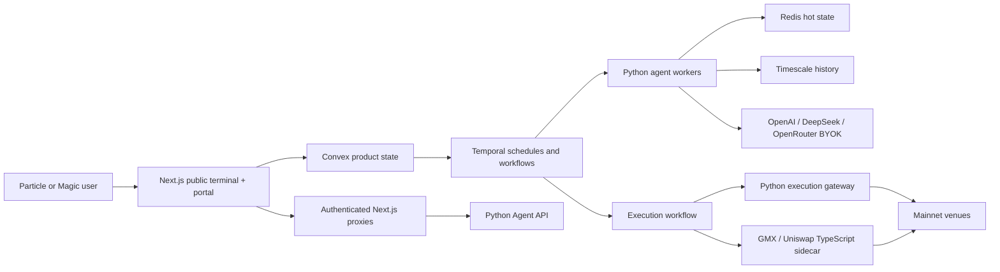

# System Architecture

Feature 22 is an isolated Test Center evaluator backed by append-only Timescale fixture history. It has no Convex projection, Temporal workflow, Redis decision cache, product enforcement, provider, signer, wallet, venue, or downstream runtime consumer.

## Simplified topology



## Deterministic run-planning fixture plane

Feature 34 compares checked-in synthetic evidence snapshots and fixed tier obligations
inside the isolated Test Center. It may retain an inert complete fixture plan or record
a skip/abstention, but it never starts Temporal work, updates Convex, reserves credits,
contacts a model, or changes product scheduling.

## Control, analysis, and execution planes

### Analytical-diversity fixture plane

Feature 38 evaluates only checked-in synthetic analytical-path dependence in the
isolated Test Center. Its append-only Timescale fixture records have no Convex,
Temporal, provider, signer, wallet, venue, execution, or product-policy consumer.

### Product control plane

Next.js and Convex own authentication-facing workflows, profile/configuration pages,
credits, policies, proposals, approvals, venue readiness, and current snapshots.
Frontend code normally calls generated Convex APIs directly. Calls to Python pass
through narrow Next.js proxies; the browser never receives `WORKER_SHARED_SECRET`.

### Analysis plane

Temporal schedules create durable cadence work. A schedule tick checks current
profile revision and runtime controls, creates an idempotent Convex job, reserves
credits, then starts analysis. Python retrieves bounded sanitized evidence from
Timescale, routes typed specialist calls, synthesizes a result, stores detailed
history, patches current Convex state, settles credits, and optionally creates a
proposal.

### Execution plane

Proposal routing is mode-dependent:

- Shadow obtains a fresh quote and records a simulated fill.
- Approval creates an expiring inbox item; approval starts a fresh execution workflow.
- Autopilot enters that same execution workflow automatically.

The workflow requotes and reruns deterministic checks. Signing is isolated in the
execution boundary and remains disabled until both live and venue-certification gates
are open. Agent/model code must never import signing adapters or credentials.

### Dependency-safety plane

Every covered boundary consumes strict, scoped owner observations and persists a
deterministic operation decision. Timescale history is written before the Convex
current projection; Temporal coordinates incident recovery by signals and timers;
Redis only coordinates expiring breakers and live UI notifications. See
[dependency safety](dependency-safety.md).

### Recovery-assurance plane

The isolated Test Center can freeze synthetic domain evidence, verify a deny-all
restore, reconcile cross-owner fixtures and issue an inspection-only verdict. Timescale
owns immutable artifacts/transitions and Redis only expiring feature leases. It never
restores production or authorizes normal resume. See
[recovery continuity](recovery-continuity.md).

### Evidence-lifecycle plane

The shared pre-sink lifecycle boundary classifies checked-in producer paths, applies
registry-owned minimization, and persists an immutable decision before governed writes
or product projections. Timescale owns history, Convex current bindings, Redis only
transformed TTL state, and Temporal durable expiry timers. Unknown content or copy
state reduces authority. See [evidence lifecycle](evidence-lifecycle.md).

### Schedule-sync fixture plane

Feature 26 folds checked-in desired-state revisions through a deterministic fake owner inside the isolated Test Center. It never imports Temporal, starts a workflow, dispatches analysis, updates Convex, or changes runtime schedules. See [schedule sync outbox](schedule-sync-outbox.md).

### Source-value attribution fixture plane

Feature 29 resolves only checked-in synthetic citation IDs and finite paired ablation
rows in the isolated Test Center. It preserves supplied/cited/supporting identity and
stores immutable fixture results in Timescale; it has no provider, product gating,
Convex, Temporal, signer, wallet, venue, or network path.

### Safety-assurance fixture plane

Feature 27 evaluates only checked-in synthetic claims, independent deterministic
oracles and semantic mutations in the isolated Test Center. Timescale holds immutable
fixture results; no corpus result changes product authority, certification, execution,
Convex state, Temporal scheduling or network behavior. See
[system safety assurance corpus](system-safety-assurance-corpus.md).

### Operational-secret custody plane

The isolated Test Center proves synthetic admission, envelope binding, receipt
ordering, lifecycle and recovery against an in-memory fake vault. Timescale stores
metadata-only history; this is not wired to product or production KMS. See
[operational secret custody](operational-secret-custody.md).

### Execution artifact certification plane

The local Test Center compares checked-in fixture observations with a deterministic
artifact graph and records immutable local decisions. It has no product projection,
execution route, signer, provider, RPC, or automatic requalification path. A local
result never opens a venue or changes execution availability.

### Instrument lifecycle plane

The isolated Test Center folds checked-in synthetic native identities, definition
versions, aliases and lifecycle events. Timescale holds immutable fixture history;
this local plane does not provide a product catalog or execution authority.

### Capability delegation plane

Feature 08 evaluates checked-in synthetic grant ancestry, observations and lifecycle
transitions inside the isolated Test Center. Timescale holds immutable fixture history;
it has no Convex projection, wallet, gateway, sidecar, provider or network path.

### Customer contestation fixture plane

Feature 23 evaluates only checked-in synthetic case graphs in the isolated Test Center.
Timescale holds append-only fixture history; it has no customer intake, Convex current
projection, Temporal deadline worker, Redis case truth, external delivery, remedy action,
provider, signer, wallet, venue or product execution path. Feature 20 is untrusted
`requires_revalidation` context only.

### Customer portability fixture plane

Feature 24 is an isolated Test Center proof over checked-in synthetic domain records. It
assembles bounded virtual bytes in memory, stores only append-only metadata in Timescale,
and returns safe aggregates. It has no Convex projection, Temporal workflow, object store,
delivery, customer-data adapter, signer, provider, or network path.

### Risk reconciliation fixture plane

Feature 09 is a separate local Test Center proof with frozen synthetic observations,
integer reservations, attempt identities and immutable reconciliation receipts. It
does not replace product risk or reconciliation owners and cannot reach execution.

### Asset conservation journal fixture plane

Feature 10 is a separate local Test Center proof over checked-in synthetic asset
movements. Timescale owns immutable exact-unit conservation history; it has no Convex
projection, Redis journal state, signer, venue, provider, gateway, sidecar or product
execution import. Feature 09 control bindings are untrusted prerequisite context only.

### Intent–execution equivalence fixture plane

Feature 11 compares only checked-in inert fixture bytes across prepared, signing-request
and dispatch observations. It has no signer, wallet, gateway, sidecar, provider, RPC,
venue, Convex, Temporal, or product projection. Feature 10 is untrusted context only.

### Venue price/liquidation fixture plane

Feature 12 evaluates checked-in exact-unit venue-shaped observations and persists
immutable local receipts in Timescale. It has no price feed, oracle, venue, signer,
gateway, sidecar, Convex, Temporal or product projection; Feature 07 is frozen
`requires_revalidation` context only.

### Incident communication fixture plane

Feature 15 is a separate local Test Center proof of immutable customer-safe in-app
intents and distinct display/acknowledgement receipts. It has no Feature 01/02/14
runtime authority, product projection, external channel, Convex or Temporal workflow;
acknowledgement never changes incident state or authority.

### Safety change quorum fixture plane

Feature 16 is isolated Test Center replay over checked-in mutations and synthetic
untrusted qualifications. Timescale keeps immutable local receipts; there is no Convex
projection, Temporal workflow, signer, wallet, venue, RPC, provider, or product path.
Feature 17 qualification is always `UNKNOWN`, so a fixture result cannot enforce or
activate product controls.

### Operator qualification fixture plane

Feature 17 stores synthetic drill, review and fixture-grant history in Timescale only.
It is exposed only through the isolated Test Center and has no product, Convex,
Temporal, workforce, provider, signer, venue or network authority.

### Mandate-to-policy fidelity fixture plane

Feature 18 compiles only reviewed typed local mandates and stores synthetic immutable
mapping, test, diff and consent evidence. Its boundary receipt is non-authorizing:
product and effective authority remain unavailable, and it has no Convex policy,
signer, execution, provider or network path.

### Execution-quality routing fixture plane

Feature 32 compares only checked-in, exact-integer quote, book, cost and submission
channel fixtures after an explicit same-operator Feature 31 selection. It persists
immutable local research results in Timescale through the isolated Test Center. It
does not import the networked router or invoke a provider, venue, signer, wallet,
gateway, sidecar, Convex, Temporal, or any external network operation.

### Calibrated Shadow/TCA fixture plane

Feature 33 consumes a selected Feature 32 fixture as untrusted `requires_revalidation`
context. It folds checked-in synthetic CLOB or Arbitrum AMM lifecycle and cost facts
into deterministic research receipts, never a product Shadow fill. Timescale holds
only local append-only fixture history; no product routing, execution, provider,
venue, signer, wallet, gateway, sidecar, Convex, Temporal, or network path exists.

## Service ownership

| Service | Owns | Must not own |
| --- | --- | --- |
| Next.js `:3102` | UI, sessions, backend proxies | Provider/venue secrets |
| Convex | Canonical product state, current snapshots, ledger | Detailed model history |
| Agent API `:9100` | dispatch, routing, providers, monitoring, controls | Browser authentication UI |
| Temporal `:17233` | durable schedules, retries, workflow state | Product source of truth |
| Workers | evidence analysis and proposal generation | Wallet or venue signing |
| Timescale `:15432` | evidence, calls, traces, analysis history | Current UI state |
| Redis `:16379` | coordination, caches, caps, runtime controls | Durable customer records |
| Gateway `:9200` | quotes, deterministic preflight, Python venues | LLM analysis |
| Sidecar `:9300` | GMX SDK and Uniswap transaction preparation | Owner-key persistence |

## Repository map

| Path | Responsibility |
| --- | --- |
| `app/` | Next.js product routes and server proxies |
| `components/` | shared portal, terminal, wallet, agent, and visualization UI |
| `convex/` | schemas, authenticated product APIs, worker bridge |
| `agent-service/` | Python contracts, providers, workflows, data, routing, gateway |
| `execution-sidecar/` | TypeScript GMX/Uniswap boundary |
| `lib/` | browser/server clients, wallet abstractions, terminal domain helpers |
| `tests/` | TypeScript domain and application contracts |
| `agent-service/tests/` | Python unit/provider/routing/security contracts |
| `docs/` | architecture and operational knowledge |
| `scripts/` | supported Windows local-stack lifecycle |

## Key request paths

```text
Browser -> Convex generated API
Browser -> /api/agent-providers/* -> Python /v1/providers/*
Browser -> /api/agent-monitoring/* -> Python /v1/monitoring/*
Browser -> /api/agent-backend/* -> allowlisted Python routes
Python -> CONVEX_WORKER_URL /worker -> convex/http.ts -> internal functions
Temporal -> Python activities -> Convex / Redis / Timescale / providers
Execution workflow -> gateway/sidecar -> venue -> reconciliation -> Convex
```

Provider and monitoring proxies verify the signed Particle session, forward only the
subject plus shared service authorization, and enforce allowlists. The generic agent
backend proxy is broader and must stay narrowly allowlisted.

## Deeper diagrams

- [Autonomous backend architecture](../agentic-backend-architecture.md)
- [Arbitrum venue architecture](../arbitrum-venue-architecture.md)
- [Venue routing architecture](../venue-routing.md)

## Outcome-calibrated promotion fixture plane

Feature 36 is a local Test Center evidence plane. Its immutable synthetic receipt graph
does not project to Convex, Temporal, Redis decision state, product configuration, or
any execution service.

## Calibrated selective-prediction fixture plane

Feature 37 is a local Test Center replay over checked-in synthetic forecast and outcome
facts. Timescale stores append-only fixture receipts only. It has no Convex projection,
Temporal refresh, Redis decision cache, product proposal consumer, provider, signer,
wallet, venue, execution, or network capability.
