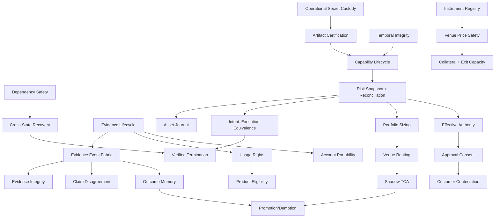

# Unimoazi Agentic-System Architecture Roadmap

## Final outcome

Twenty-three cycles examined sixty-nine candidates and produced thirty-eight approved
feature dossiers. Cycles 18–23 approved no new dossiers, satisfying the final
six-consecutive-zero stop rule. Research is stopped: further ideas in the surveyed
space now map to an existing owner, lack evidence, or violate a hard gate.

The strongest result is not a new agent framework. Unimoazi should extend its current
specialists, quorum, critic/arbiter, Evaluation Lab and deterministic execution
boundary with authoritative state, bounded capabilities, certified artifacts,
recoverable workflows and evidence-linked outcomes.

This roadmap orders future human implementation review. It authorizes no code change,
provider call, deployment, signing, funded test or onchain action.

Integration status (2026-08-06): items 1 and 2 are locally implemented. Dependency
Safety remains product-observe; Recovery Continuity is incomplete/activation-gated and
available only for checked-in isolated Test Center drills. Product recovery remains
`UNKNOWN`, normal resume is always blocked, and no production backup/restore claim is
made. The exact queue and status are `FEATURE-REGISTRY.json` and
`IMPLEMENTATION-STATUS.md`.

Feature 27 is locally implemented as a default-off Test Center assurance corpus. It
maps checked-in synthetic claims to deterministic oracles and mutations only; it is
not safety certification and has no product/runtime authority.

## Dependency map

Arrows mean “needs a stable contract or evidence product from,” not necessarily “must
finish every implementation first.” Independent local fixtures can proceed in
parallel, but no production-facing activation may bypass its prerequisites.

## Recommended implementation-review order

### Phase 0 — Control, custody and recovery foundations

1. **Cross-Layer Dependency Safety Envelope.** Make operation-specific degraded-mode
   decisions and preserve reconciliation/recovery during outages.
2. **Cross-State-Owner Recovery and Continuity.** Prove isolated restore and
   cross-owner reconciliation for Convex, Timescale, Redis and Temporal.
3. **Evidence Lifecycle Boundary.** Minimize before persistence and make retention,
   deletion and legal hold explicit for every copy.
4. **Non-Owner Operational Secret Custody.** Separate API/service-secret lifecycle
   from Particle/Magic owner keys; keep activation cloud/KMS-approval gated.
5. **Execution Artifact Certification.** Bind exact code, proxy, ABI, chain and
   dependency identity; invalidate certification on drift.
6. **Temporal Integrity and Causal Sequencing.** Define clock domains, uncertainty,
   causal order and signer-scoped nonce leases.
7. **Canonical Instrument Lifecycle Registry.** Replace symbol identity and list
   position with versioned economic identity and lifecycle events.

### Phase 1 — Authoritative execution truth

8. **Capability and Delegation Lifecycle.** Issue bounded, expiring, revocable grants
   to deterministic services; never grant tools or credentials to models.
9. **Authoritative Risk Snapshot and Reconciliation.** Reserve concurrent exposure,
   reject missing/stale inputs and recover uncertain submissions.
10. **Asset Conservation Journal.** Reconcile exact-unit postings to external owner
    receipts without pretending the journal is custody truth.
11. **Intent–Execution Equivalence.** Prove that reviewed intent and exact dispatched
    bytes have the same permitted effects under pinned state.
12. **Venue Price and Liquidation Safety.** Normalize venue-specific mark, index,
    oracle and liquidation semantics with provenance and freshness.
13. **Collateral Resilience and Exit Capacity.** Stress usable collateral and actual
    close, settlement and withdrawal capacity.
14. **Verified Strategy Termination.** Coordinate revoke/cancel/reconcile/export and
    prove terminal state or explicit residual obligations.

### Phase 2 — Governance, operators and customer rights

15. **Safety-Incident Communication Outbox.** Persist audience, approved template,
    delivery, acknowledgement and escalation independently of incident detection.
16. **Safety-Critical Change Quorum.** Require genuine independent human approval for
    relaxations; keep shutdown and recovery possible without quorum.
17. **Operator Qualification and Drill Readiness.** Make current training and bounded
    local-drill evidence a prerequisite for privileged roles.
18. **Mandate-to-Policy Semantic Fidelity.** Compile a typed, user-approved mandate;
    bind activation to exact hashes and deterministic semantic diffs.
19. **Effective Authority Decision.** Project canonical policy, signer, venue, risk
    and reconciliation receipts without creating another authority source.
20. **Risk-Tiered Approval Consent.** Present material deltas, bind owner consent and
    rerun all deterministic gates after requote.
21. **External Usage Rights and Product Eligibility.** Keep separate deterministic
    rulepacks for permitted evidence use and customer/product eligibility; qualified
    legal assertions are mandatory activation inputs.
22. **Customer Contestation and Account Portability.** Add human findings, appeals,
    remedy authorization and verified export without automatic financial action.

### Phase 3 — Evidence, proposal and outcome quality

23. **Evidence Event Fabric and Schedule Sync Outbox.** Establish immutable
    provenance, revision links, replay manifests and durable desired-state dispatch.
24. **System Safety Assurance Corpus.** Link invariants, adversarial scenarios and
    owner evidence; it informs release review but never authorizes production.
25. **Manipulation-Aware Evidence Integrity and Claim Disagreement.** Detect source
    dependence, corrections and material contradictions before escalation experiments.
26. **Portfolio Sizing, Venue Routing and Shadow TCA.** Freeze exact risk, size and
    route inputs; compare certified expected and actual lifecycle receipts.
27. **Deterministic Run Planning.** Begin with skip/no-change versus the complete
    current tier; reduced specialist sets remain experiment-only.
28. **Outcome Memory and Promotion/Demotion.** Capture immutable outcomes first; allow
    bounded retrieval and configuration changes only after mature chronological data.
29. **Selective Prediction, Source-Value Attribution and Diversity Audit.** Remain
    Evaluation/Shadow work until market- and horizon-specific cohorts are powered.

## Activation gates

| Dossier | Gate before anything beyond local replay/Shadow |
| --- | --- |
| Recovery and continuity | Approved infrastructure/storage cost, isolated restore environment and owner runbook |
| Operational secret custody | Explicit cloud/KMS cost approval; no owner-key custody or fallback key |
| Safety quorum and operator qualification | Two genuinely independent qualified people; no fake account-level independence |
| Usage rights and product eligibility | Qualified, jurisdiction-specific legal/commercial assertions with freshness |
| Contestation | Staffed human reviewer/appeal path and separately authorized remedy execution |
| Account portability | Approved secure delivery/temporary-storage channel and retention policy |
| Routing, TCA and venue safety | Certified adapters and sufficiently matched Shadow/actual receipts |
| Memory, promotion and prediction | Powered chronological cohorts, drift checks and deterministic kill criteria |

These gates are prerequisites, not benefit assumptions. Missing, stale or disputed
inputs reduce authority, force abstention or block activation.

## Saturation-cycle fold index

The last six cycles tested whether apparently distinct trading mechanisms deserved
new top-level owners. They did not:

| Mechanism | Existing owner(s) |
| --- | --- |
| Vendor exit/substitution | Dependency safety, continuity, rights, secrets, certification, termination |
| Data correction | Domain evidence owner plus Evidence Event Fabric revision links |
| Chain finality/profile | Dependency safety, Temporal integrity and reconciliation |
| Protocol upgrades | Artifact certification, Instrument registry, Evidence Fabric and assurance |
| Intent collision/self-trade prevention | Portfolio sizing/proposal coherence and routing |
| Solver auctions and RFQ | Certified routing mechanisms, not agent frameworks |
| Dead-man switch, mass cancel and protective orders | Termination, capability, Temporal and receipt owners |
| Oracle sessions and market halts | Evidence/price safety and Instrument lifecycle fields |
| Drop copy | Independent reconciliation evidence |
| TWAP/VWAP | Sizing/routing schedule with Temporal and TCA receipts |
| Native credit and ADL | Risk, collateral stress, venue safety and reconciliation |
| Request budgets | Dependency safety, Temporal sequencing and Redis coordination |

Customer inheritance/succession remains rejected/deferred until Particle/Magic-native
owner recovery and qualified legal scope exist. A universal SLO controller,
correction service, oracle service or second execution intent compiler remains
rejected because it would duplicate or blur domain authority.

## Architecture invariants

- Arbitrum `42161` is the active strategy chain; Optimism is legacy visibility and
  user-confirmed migration only.
- Particle and Magic remain the only owner signers. No fallback owner key is created
  or stored.
- Models receive typed evidence and produce bounded analysis; they never receive
  wallet keys, venue credentials, signing adapters or execution tools.
- Deterministic code owns policy, authority, materiality, risk, sizing, routing,
  certification, admission, signing eligibility and execution.
- Convex owns current authenticated product state; Timescale owns detailed evidence
  and history; Redis owns ephemeral coordination/reservations; Temporal owns durable
  work.
- Stable idempotency keys survive retry and uncertain submission. Every state-changing
  boundary emits an immutable or revision-linked receipt.
- Development starts with fixtures, replay, adversarial cases, local simulation and
  Shadow mode. Paid providers, CI, cloud, deployment, wallet and onchain tests need
  separate disclosure and explicit approval.

## Benefit and release policy

No dossier or combination of dossiers has a justified PnL, Sharpe or drawdown claim.
Near-term benefits are measurable invariants: complete lifecycle receipts, no policy
pass with missing authoritative input, bounded/revocable capability, reproducible
decisions, deterministic recovery and no duplicate action under retry.

Percentage improvements in calibration, token use, contradiction handling or repeated
errors remain labeled hypotheses in their dossiers. Each must pass its own sample-size,
replay, adversarial, Shadow and kill criteria. A high weighted score prioritizes human
review; it is not implementation or activation authority.

## Program exit

Research stopped after Cycle 23. Review and explicitly authorize one bounded dossier
at a time if implementation is desired. Any paid provider, cloud resource, CI runner,
deployment, private signer setup, funded canary or onchain validation requires a new
cost disclosure and explicit approval.
