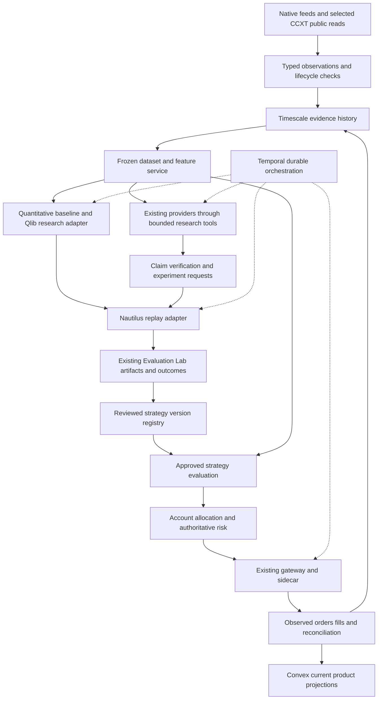

# Integration blueprint for the existing app

This is a proposed architecture derived from the research, not an implementation or migration. Each external adapter remains conditional on the [validation roadmap](validation-roadmap.md). Existing wallets, model providers, customer modes, and safety gates retain their current meaning.

## Place components beside their existing owners

The trading calculations and state transitions are domain services. LLMs can request research calculations, but cannot call the execution boundary. Temporal owns durable process coordination; individual market events need not become workflow histories. Shared feeds are services, not Convex job pollers.

| Existing owner | Proposed extension | Must remain outside it |
| --- | --- | --- |
| Convex | Current strategy assignment, approved version references, current decision and execution summaries | Large replay datasets, full market history, raw provider or venue credentials |
| Timescale/PostgreSQL | Versioned observations, snapshots, experiment artifacts/metadata, claims, authoritative execution history | Model-chosen authority or an implicit live-state cache treated as current truth |
| Redis | Expiring coordination, demand, hot derived data, and budget reservations | Sole durable position ledger, sole risk reservation journal, or authority restored by cache recovery |
| Temporal | Research jobs, bounded evaluation steps, approval waits, durable execution recovery | Per-tick order-book storage or model credentials in payloads |
| Python research workers | Quant libraries, replay adapter, grounded provider calls, experiment requests | Owner keys, venue credentials, order submission tools |
| Gateway/sidecar | Venue-specific permission, quote/preflight, signing, order management, reconciliation | Free-form LLM strategy selection |

Large research exports would need explicit lifecycle-approved storage before introduction. Start with bounded local exports for disposable experiments. Do not quietly make DuckDB files or a new artifact service another permanent source of truth.

## Proposed interfaces

These are minimum integration contracts, not new public API endpoints. Keep adapters internal until their fields and ownership are tested. Version their serialization; do not replace current product payloads wholesale.

| Contract | Minimum information | Producer and consumer |
| --- | --- | --- |
| `MarketObservation` | Exact instrument/venue/chain identity, source event ID, event and receive times, publication time where known, units, values, sequence/finality state, source revision and quality failures | Feed adapter to evidence/feature service |
| `EvidenceSnapshot` | Snapshot ID/hash, decision cutoff, observation and passage references, gaps, lifecycle/rights status | Evidence service to models, strategies, and replay |
| `CalculationReceipt` | Function/version, typed arguments, input snapshot, output units/value, validity interval | Reviewed calculation tools to claim verifier and strategy evaluation |
| `GroundedClaim` | Claim category, instrument/horizon, evidence or calculation references, supplied/cited/supporting identities, verification result | Text analyst to verifier and research artifacts |
| `ExperimentArtifact` | Hypothesis, code/config hash, dataset/cost versions, chronological split manifest, all trials, outputs and failure reasons | Qlib/RD-Agent/replay adapters to Evaluation Lab |
| `StrategyVersion` | Frozen calculation/model, allowed features and instruments, parameter bounds, invalidations, evaluation/promotion references | Reviewed registry to operating workflow |
| `SignalIntent` | Strategy/version, snapshot, horizon, target/opportunity, invalidation and expiry; no signature or raw credentials | Strategy evaluation to allocator |
| `RiskDecision` | Account/strategy scope, authoritative state version, policy version, reservations, exact permitted limits, checks, expiry, idempotency identity | Risk owner to existing execution boundary |
| `ExecutionOutcome` | Native order/transaction identifiers, observed event sequence, partial fills/costs, resulting positions, uncertainty/finality and reconciliation state | Execution boundary to durable history and current projections |

Execution quantities and money should use explicit fixed units or decimal representations, then venue rounding and exact checks. Floating-point arrays are acceptable for statistical research when their limits are recorded; they should not become unvalidated transaction amounts.

## Research workflow

1. An operator or customer requests a bounded research objective using the current preview/budget flow.
2. Temporal freezes the allowed universe, data snapshot, routes, prompt versions, experiment protocol, and resource ceiling.
3. The planner chooses from registered tools such as `get_snapshot`, `compute_feature`, `read_source_passage`, `run_registered_backtest`, and `compare_experiments`.
4. Independent quantitative and text work produces typed artifacts. A claim verifier resolves numbers and evidence before downstream use.
5. The researcher proposes an experiment. Generated code, if enabled through RD-Agent, runs only in an isolated environment with reviewed inputs and limits.
6. The experiment runner records every candidate, failed run, and result. The challenger examines explicit failure cases and can request one bounded revision in the initial prototype.
7. Evaluation returns evidence and a recommendation. It does not activate a route, strategy, customer mode, or trading permission.

The provider bridge must use Moeazi's existing model configuration, lifecycle admission, budget reservation, cost settlement, and trace rules. A third-party framework that silently instantiates its own clients must be adapted or rejected. No provider switch or credential export is part of this proposal.

Research autonomy is broad within a finite scope: an agent may discover a new hypothesis, request additional permitted calculations, and compare outcomes. Its scope is not a license to use arbitrary internet sources, install packages, spend without a ceiling, or deploy code.

## Operating workflow

1. A schedule or relevant event selects an approved strategy version and a fresh evidence snapshot.
2. Its frozen calculation produces an intent or abstains. An optional LLM-derived feature is usable only if explicitly part of the evaluated strategy and verified at the required level.
3. The account service combines all active strategy intents into target exposure. Opposing strategies cannot independently spend the same collateral.
4. The risk owner atomically reserves capacity against current positions, open orders, unresolved submissions, and other reservations. Aggregate by the real collateral/authority scope, including strategies sharing a wallet.
5. Customer mode decides simulation, fresh approval, or bounded automatic execution. Current deployment/certification gates still apply.
6. Gateway/sidecar requotes and revalidates the exact action. Submission intent is durable before external effects; an uncertain result enters reconciliation rather than blind retry.
7. Observed venue events update durable order/account history, then current UI projections. Outcomes mature only after the relevant horizon and reconciliation state are established.

There must be one owner for each order lifecycle. Do not have Freqtrade, Nautilus, and the existing workflow independently submit/manage the same order. Initial engine integration is replay-only. Any later native execution engine integration requires an explicit transfer or adapter design, not two competing state machines.

## Grounding rules at the boundary

**Evidence identity:** separate material supplied to a model, material it cited, and material independently verified to support each claim. Never repair an invalid citation by substituting the input list. Resolve cited IDs on the server; exclude stale, wrong-account, wrong-instrument, future-dated, or lifecycle-ineligible evidence.

**Claim categories:** an observation references a source field/passage; a derived fact references a calculation receipt; a hypothesis stays a hypothesis; a forecast includes an outcome definition and horizon. A claim can be well-supported while the source itself is unreliable, so source provenance and source-family dependence are separate checks.

**Deterministic and semantic checks:** instrument identity, units, arithmetic, timestamps, permissions, and limits use code. Textual support can use the current semantic evaluator or a Ragas comparator, but uncertain judge results do not authorize execution. A high aggregate score never cancels a failed critical check.

**Abstention:** missing facts, conflicting authoritative inputs, unsupported critical claims, and insufficient calibrated evidence produce a structured reason to abstain. Do not substitute model memory, a stale cache, or a more confident persona for missing data.

**Threat boundary:** retrieved content remains untrusted data. Tool permissions enforce available actions even if a prompt injection succeeds. No model-visible tool can sign, withdraw, alter live policy, certify a venue, or retrieve provider/venue secrets. This prevents some consequences of hallucination; it does not guarantee every textual claim is correct.

## Portfolio and execution responsibilities that remain custom

CVXPY can compute allocations but cannot tell Moeazi whether balances, mark prices, collateral rules, or venue permissions are authoritative. Build a narrow risk service with explicit unknown states and versioned account snapshots. Recheck constraints after rounding and immediately before dispatch.

For compatibility with current ownership, keep current account risk/reservation state and compare-and-set transitions in Convex; keep detailed observations, decision receipts, and reservation history in Timescale. Bind the two through versioned references and durable workflow steps. Do not assume an atomic transaction across the stores: a missing history receipt or mismatched projection blocks new exposure until reconciled. Redis leases can coordinate work but cannot restore spent capacity or clear an uncertain reservation.

Maintain a separate path for already-authorized protective operations. Exhausted LLM credits, a research queue backlog, or a failed analyst must not silently disable reconciliation or permitted risk reduction. Conversely, “emergency” must not become a blanket bypass of owner permissions or uncertain account state.

Pausing entries, cancelling orders, closing positions, and revoking delegation are different operations. A stop-loss is not a guarantee of the exit price or execution under venue failure. Model native order support and the residual risk of emulated exits explicitly.

For Arbitrum transaction paths, observe receipt/finality and reorg semantics. For external venue accounts, use native order and account semantics. A canonical strategy chain does not make every venue an EVM order book. AMM swaps and CLOB orders need different simulation and recovery contracts.

## Deployment shape for 10 to 100 accounts

Start with the existing stack plus a separate disposable research/replay worker environment. Keep GPU infrastructure, additional brokers, distributed actor frameworks, and separate vector databases out of the first experiment. These are scope choices, not performance claims.

Share public observations and calculated features by instrument, cutoff, source version, and feature version. Shared model work also requires matching route/prompt configuration, permissions, and billing ownership; private account evidence and BYOK work must not leak across accounts.

Use bounded queues and concurrency. Give order supervision/reconciliation separate capacity from long-running research. Coalesce redundant market triggers, apply venue-wide rate limits, and enforce account-specific budgets. Public demand TTLs and the zero-idle-Convex rule remain intact.

Instrument evidence age, queue delay, model failure/abstention, risk rejection, unresolved order age, reconciliation drift, realized costs, and per-account resource use. Configure alerting from a declared operating target after V8 measurements rather than inventing latency promises now.

## Compatibility and promotion

Keep current `SignalReport`, `MarketSynthesis`, and visualization payloads as descriptive interfaces. Add internal experiment/intent adapters alongside them; historical rows lacking the new provenance remain legacy or research-only. No silent backfill should assert verified evidence or calibrated probability.

Promotion binds an exact strategy/data/model/parameter version to an explicit review record. Compare the baseline, candidate, and forward Shadow evidence before changing availability. A rollback stops new entries and handles existing positions through a reviewed policy; it does not erase their history.

Existing Test Center features supply valuable adversarial scenarios and domain concepts. Their synthetic receipts must not be imported as live instrument, risk, custody, calibration, or promotion truth. Authoritative producers and consumers are separate later implementation tasks.
