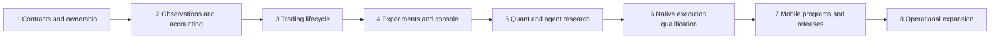

# Moeazi master architecture and evolution roadmap

Research date: 30 September 2026. Audience: Moeazi's product owner and engineers implementing the next stages. This is a research and implementation specification, not a claim that the proposed system has been built or certified.

Moeazi has a substantial product, agent orchestration, and evaluation foundation. Its central missing capability is a complete, authoritative trading lifecycle connecting observations, strategy decisions, account risk, execution, protection, and reconciliation. The recommended evolution is to complete that shared backend, expose it through a separate local operator console, and assign a versioned Moeazi-managed program to mobile accounts. Web customers retain their own teams and modes.

The recommendation is a **hybrid integration**: preserve Moeazi's ownership and durable orchestration; qualify existing open-source engines for simulation and research; use native execution adapters behind Moeazi's authority boundary; build only the account-specific contracts, risk ownership, release rules, and integration code that external projects do not provide. Do not make a wholesale engine replacement or a disconnected research application the starting assumption.

## Fixed product vision

| Surface | Purpose and control |
| --- | --- |
| Web | Customers create multiple teams, save configurations, and choose Shadow, Copilot/Approval, or Autopilot per supported deployment. |
| Mobile | Customers authorize a Moeazi-managed program and observe, learn, stop, and withdraw. Moeazi designs strategies and risk limits; customers do not tune trading parameters. |
| Local operator console | Operators inspect actual backend state, clone candidates, run experiments, compare results, and eventually release versions through authenticated backend commands. Closing this UI does not stop trading. |
| Shared backend | Common account identity, data, agents, calculations, risk, execution, supervision, accounting, and recovery. Experiments use isolated simulated accounts, not separate implementations of the trading rules. |

Preserve Particle/Magic owners, configured model providers, existing infrastructure responsibilities, and all current interfaces. New tools must be open source. The destination includes spot and perpetuals for 10–100 accounts. Existing on-ramp/provider dependencies are not silently replaced by this requirement. Open-source code does not make data, gas, hosting, or model usage free.

No first venue, first traded instrument, production leverage, loss threshold, or allocation percentage is approved by this report. ETH, Hyperliquid, and Uniswap are practical qualification candidates; earlier conversational numerical limits were illustrations, not validated policy. [Execution qualification](execution-and-authority.md) and [open gates](validation-and-gates.md) define how to decide.

## First principles

Autopilot accepts limited authority over a customer's capital, makes decisions under uncertainty, and must remain accountable for every resulting obligation. The objective is a qualified investment process within an approved risk mandate; activity, agent agreement and generated explanations are not success measures. Staying in cash can be the correct result.

| Necessary capability | Why it is necessary | Authoritative output |
| --- | --- | --- |
| Account identity and consent | The system must know whose assets it may affect and under which mandate | Versioned account/controller/permission binding |
| Trustworthy observations | A correct calculation on stale, misidentified or future data can still be wrong | Point-in-time evidence snapshot |
| Strategy discovery and quantitative analysis | A plausible story must become a falsifiable, cost-aware hypothesis | Frozen strategy and reproducible calculation artifacts |
| Simulation and evaluation | Candidate behavior must be compared before capital is exposed | Qualified results with assumptions and failure cases |
| Grounded agent collaboration | Interpretation is useful only when claims and numerical consequences can be checked | Verified claims, uncertainty and abstention |
| Portfolio/account risk | Individually acceptable trades can collectively exceed collateral or exposure | Reconciled snapshot and atomic reservation |
| Execution and reconciliation | A request, acknowledgement and settled fill are different facts | Observed order/fill/settlement journal |
| Continuous protection | Exposure persists while analysts, browsers and providers are unavailable | Independently supervised positions and explicit degraded states |
| Accounting and withdrawal | Customers need truthful outcomes and control over available capital | Cashflow-aware balances, P&L and verified transfers |
| Versioned releases and operations | Improvements and failures must not silently change an existing obligation | Compatible assignment, recovery and audit evidence |

Open-source projects can supply algorithms and substantial subsystems. Moeazi must still own the integration of customer authority, financial truth and release responsibility. The comparisons below evaluate tools against those needs rather than assuming an LLM committee constitutes a trading system.

## Read and implement in order

| Document | Question answered |
| --- | --- |
| [Current system](current-system.md) | What actually exists, what is incomplete, and how the five customer/operator journeys behave |
| [Target architecture](target-architecture.md) | Which subsystem owns each capability and how the surfaces connect |
| [Contracts and state](contracts-and-state.md) | Identity, versioning, account accounting, authority, and cross-service consistency |
| [Trading component decisions](trading-components.md) | Data, engines, quantitative research, and allocation alternatives |
| [Agent and grounding decisions](agent-components.md) | Collaboration, verification, uncertainty, and controlled research |
| [Operator tooling decisions](operator-components.md) | Existing Lab versus Hummingbot, MLflow, Optuna Dashboard, and a thin connected console |
| [Execution and authority](execution-and-authority.md) | Operation-level venue status, permissions, and qualification requirements |
| [Stages 1 and 2](stages-01-02.md) | Contracts/ownership, then trustworthy observations and accounting |
| [Stages 3 and 4](stages-03-04.md) | Complete simulated lifecycle, then connected experiments and console |
| [Stages 5 and 6](stages-05-06.md) | Quantitative/agent research, then native execution qualification |
| [Stages 7 and 8](stages-07-08.md) | Managed mobile releases, then operational expansion |
| [Validation and unresolved gates](validation-and-gates.md) | Experiments, acceptance, costs, release restrictions, and unanswered questions |
| [Evidence register](evidence-register.md) | Code sources, upstream revisions, scope, and research limitations |
| [Implementation ledger](implementation-ledger.md) | Current implementation status, published stages, verification evidence and next work |
| [Internal prototype checkpoint](prototype-fast-track.md) | End-to-end mobile path, current native route gates, and the next vertical slice |
| [Model and authority separation](model-authority-separation.md) | Future correction: replace mobile AI models without changing a customer's funded mandate or vault |
| [Stage 3 foundation checkpoint](stage-03-release.md) | User-requested scope freeze, working spot lifecycle, release evidence and explicit remaining Q4 gates |

## Principal findings

1. **Reuse the multi-team foundation.** Team versions and deployment IDs already reach jobs, analysis configuration, proposals, and some projections. Some guides still describe one team, while mobile still selects the first profile. Complete identity propagation and explicit mobile assignments; do not start a replacement team system.
2. **Agent analysis is not yet a measured strategy engine.** Synthesis combines reported confidence and directional scores; proposal construction applies simple thresholds and caps. Calibration, signal validity, position sizing, and net economic value require separate evidence.
3. **Grounding needs a local correction before a new framework.** Both production orchestration and Evaluation Lab v2 overwrite model citations with supplied references. This can conceal unsupported attribution. Typed JSON is not proof of truth.
4. **Execution scaffolding is not live account management.** Risk inputs include placeholder zeros; signing is gated/unimplemented; an execution workflow can mark a proposal executed after an uncertain or simulated result. A full order/fill journal, risk reservations, and persistent position supervisor are missing from the inspected normal path.
5. **The Test Center is useful evidence infrastructure, not a production authority.** Its synthetic journal, risk, permission, termination, and promotion scenarios cannot become authoritative observations merely by connecting a UI.
6. **The console should extend backend capabilities.** Keep the current Lab and Test Center available. Add a separate UI and narrow operator APIs; retain backend experiment storage, durable work, provider routing, and budgets. No separate SQLite research system is recommended.

These are source-inspected findings and architectural judgments. They are not results of live probes. Details and narrower qualifications appear in the linked chapters.

## Recommended combination

| Responsibility | Decision |
| --- | --- |
| Product ownership and durable work | Reuse Convex, Timescale/Postgres, Redis, Temporal, existing team versions, provider routing, and wallet boundaries. |
| Observation adapters | Prototype native recorded-response adapters and selected CCXT public reads; retain source-specific validation. |
| Trading lifecycle | Bounded Moeazi account supervisor and journal; qualify Nautilus replay and borrow lifecycle patterns before any engine-hosting decision. |
| Quantitative research | Deterministic baseline first; adopt scikit-learn for controlled comparisons; prototype Qlib and later isolated RD-Agent. |
| Allocation | Simple deterministic risk-budget allocator first; prototype CVXPY only against the same constraints and rounding checks. |
| Agent grounding | Preserve citations, typed observations, deterministic calculation receipts, claim checks, abstention, and offline judge comparison. |
| Operator UI | Thin connected Moeazi console; borrow Hummingbot workflow patterns; defer MLflow/Optuna UI until their specialized capabilities justify integration. |
| Live execution | Qualify native SDK operations inside the existing gateway/sidecar; never expose their private clients to analysts. |

Every prototype has a rejection condition. A rejected package does not invalidate the architecture: the fallback is recorded in its decision entry and stage brief. None of these decisions claims a profitable strategy.

## Sequential delivery

Stage numbers are stable implementation units. Each brief specifies prerequisites, outputs, interfaces, tests, rollback, costs, and unavailable behavior after completion. A failed prerequisite blocks dependent activation, not unrelated read-only research. Safety, isolation, and operator visibility begin in early stages; they are not postponed to Stage 8. Thin console views may appear early, but the Stage 4 gate requires actual backend-created experiments.

## Relationship to the earlier research

The [original report](../agentic-trading/README.md) remains intact as a component dossier. This master report is the planning reference for the complete vision. It changes emphasis and fills omissions:

- Broader scope: multiple web teams, mobile assignments, funding/withdrawal authority, and a backend-connected console.
- Earlier Nautilus/Qlib recommendations remain **prototypes**, not mandatory dependencies or live-engine selections.
- Hummingbot Dashboard/API, MLflow, Optuna Dashboard, OpenBB, FinRL-X, and native SDK permission boundaries receive additional review.
- Financial state, account reservations, position management, program promotion, and migrations now have named owners and staged acceptance.
- Old V0–V8 experiments are mapped into the new Q-series qualification register; past evidence is reused rather than erased.

## Research boundary

This work read local code and public primary sources. It did not run customer journeys, launch services, deploy Convex, collect account data, install upstream projects, invoke models, submit trades, or certify financial performance. Documentation integrity checks are the only checks executed for this deliverable. All runtime verification remains a stage requirement. See the [evidence register](evidence-register.md) for exact inspection scope.
