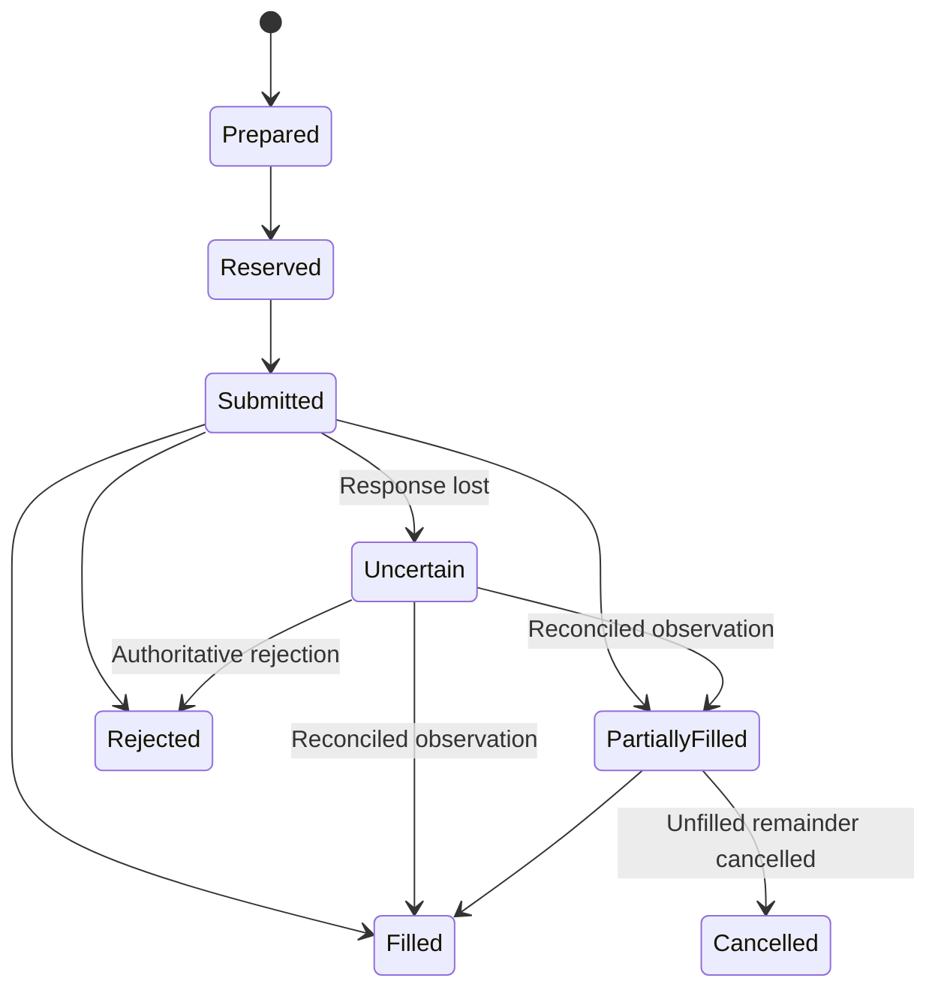

# Integration contracts and financial state

These are the minimum contracts for the target architecture. They extend existing Pydantic/TypeScript contracts and saved team versions; they are not a second customer identity system. Stage 1 freezes schemas and Stage 2 establishes financial semantics before engine integration.

## Identity and version graph

```text
User → owner wallet → strategy account
                    ├─ customer team → saved team version → market deployment
                    └─ managed program assignment → immutable program version

Program version → strategy artifact + agent configuration + policy + adapter profile
Experiment → frozen program variants + evidence dataset + simulation model + protocol
Intent → controller version + account state revision + evidence snapshot
Order/position → originating intent and management version
Release → evaluation references + compatibility decision + account cohort
```

The new program packages existing versions; it does not replace `agentProfiles`, `agentTeamVersions`, or `agentMarketDeployments`. A web team's deployment and a mobile assignment resolve to a common controller reference. Authority is the intersection of environment ceiling, account consent, policy, native grant, and current readiness, never a property of an agent name.

## Contracts

| Contract | Required information | Producer → consumer |
| --- | --- | --- |
| `ControllerRef` | Environment, strategy account, controller kind (`customer_team`/`managed_program`), immutable version, deployment/assignment ID | Product resolver → all downstream work |
| `InstrumentVersion` | Native venue/chain ID, product kind, base/quote/settlement asset, decimals/tick/lot/minimums, margin/funding model and supported actions, effective time | Validated adapter metadata → observations/risk/execution |
| `MarketObservation` | Instrument version, source event ID, event/received/publication time, sequence/block/finality, exact values/units, quality and gap status | Feed → snapshot builder |
| `EvidenceSnapshot` | Cutoff, content/reference hashes, rights/lifecycle scope, available-at times, provenance, excluded/gapped observations | Evidence owner → strategy/agents/evaluation |
| `CalculationReceipt` | Reviewed function/code version, typed inputs and units, snapshot hash, outputs, validity/failure | Quant service → claim verifier/strategy |
| `GroundedClaim` | Claim kind, instrument/horizon, original citations, supporting passages/calculations, verification reasons, uncertainty | Analyst → verifier/research |
| `TradingProgramVersion` | Controller composition, exact code/model/prompt/config hashes, strategy IDs/parameters, policy, allowed instruments/capabilities, compatibility and qualification references | Registry → experiment/strategy runtime |
| `TradeIntent` | Controller, instrument, action (`spot_buy`, `spot_sell`, `perp_open`, `perp_reduce`, `close`, `hold`), horizon, evidence, invalidation, expiry, desired exposure, protection intent | Strategy → allocator |
| `AccountRiskSnapshot` | Ledger revision, confirmed/provisional assets, open orders/positions/reservations, valuation references, fees/funding, freshness, reconciliation, policy revision | Financial owner → risk |
| `RiskReservation` | Account/intent/permit identity, exact reserved assets/exposure/exit costs, snapshot and policy revision, state, expiry and uncertainty retention | Risk owner → execution/journal |
| `ExecutionPermit` | Reservation, exact normalized action/payload hash, native account/venue, amount caps, price/slippage bounds, nonce domain, policy/grant revisions, expiry | Risk and authority owners → gateway |
| `ExecutionEvent` | Environment/account/intent, client and native IDs, event kind, observed quantity/price/fee/funding, time/finality, source evidence, dedupe key | Adapter → journal/supervisor |
| `ExperimentSpec` | Frozen variants, dataset/cutoffs, starting states, simulation version, costs, seeds, splits, metrics/criteria, call/resource budgets | Operator/customer research → evaluation worker |
| `ProgramRelease` | Exact program hash, qualification evidence, account selection, previous assignments, authorizer, compatibility and rollback target | Operator API → product assignment owner |

All schemas reject unknown fields at authority boundaries and unknown units/identities. Statistical arrays can use floats within a numerical library; money and signed amounts use integer native units or explicit decimal strings, with rounding checked at the boundary. `directional_score` stays signed; agreement strength and calibrated probabilities are separate fields.

A trace carries supplied, cited, and verified-support references separately. Do not overwrite a model's citations to make them match available evidence. Every machine-generated financial number shown to a user references a calculation or observed ledger value.

## Financial source of truth

External venues/chains are the source for observed settlement; Moeazi's financial owner maintains the reconciled operational view and admits risk. A journal entry does not manufacture proof that assets exist externally.

Use ordinary PostgreSQL transactional tables within the existing Timescale/Postgres service for account revisions, balanced journal postings, reservations, order identity, and outbox records. Detailed immutable observations and history can use the existing Timescale facilities. Do not rely on hypertable behavior for cross-account uniqueness without an explicit constraint design.

In one account-scoped database transaction:

1. Verify the expected account revision and current reconciliation state.
2. Fold deduplicated external observations and existing reservations.
3. Check exact proposed risk against a versioned policy/configuration reference.
4. Reserve capital/exposure and record the immutable permit binding.
5. Advance the revision and append the publication outbox item.

Convex remains the owner of consent, authenticated configuration, assignments, and UI snapshots. It receives versioned projections idempotently. There is no distributed transaction between Convex and PostgreSQL: commands carry expected configuration versions; risk/dispatch verify current authority before signing; stale/missing publications cannot be interpreted as approval. Revocation and emergency-stop checks have a direct authoritative read/check path at dispatch, not only an eventually delivered UI event.

Redis locks are advisory acceleration. Database constraints/transactions plus fencing prevent two workers spending the same balance after a lease expires. Temporal retries carry the original logical operation ID.

Consent/configuration checks cannot atomically span Convex, the financial database and an external venue. The implementation must define a dispatch admission point and serialize revocation/stop against issuance of short-lived permits with an account authority epoch. A stop acknowledges when new admissions are blocked and separately reports already admitted/in-flight requests; it cannot promise to undo a request already accepted by the venue. Q3/Q10 must test a stop racing with signing/submission, including stale epochs and an unavailable authority service.

## Required accounting semantics

- Track quantities per asset, account, venue, and location. Record internal transfer-out/in against a transit account; never count both sides as available.
- Separate external cash flows from investment return. Deposit/withdrawal adjustments cannot reset drawdown or create P&L.
- Distinguish realized P&L, unrealized marked value, fees, funding, gas, and research/service cost. Explain which costs are charged to the customer and which are platform operating cost.
- Store mark/index/oracle provenance and freshness. Unknown valuation is not zero equity or zero loss.
- Reserve entry notional/margin, pending order exposure, transaction fees, and an explicit exit-capacity buffer under the policy. Spot token reservations differ from derivative margin.
- Use gross and directional exposure across strategies; do not let opposing strategies create fictional spare collateral through netting unless native settlement and policy explicitly support it.
- Fold native fills and funding once using stable source identities. Reorg corrections append reversals/replacements rather than editing away history.
- Unknown submission retains the relevant reservation past ordinary preparation expiry. Release it only after authoritative non-submission, rejection/cancellation, expiry semantics, or settlement are established.

## Order and position lifecycle



Protection and reconciliation are separate dimensions, not a single `executed` boolean. A partially filled then cancelled entry may leave a real position requiring protection. A submitted AMM transaction has transaction/finality states rather than CLOB cancel semantics. A closed position can still have unsettled funding, a pending transfer, or unresolved journal drift.

Native IDs and client IDs are both retained. If a venue cannot prove deduplication by client ID, the adapter documents lookup-before-retry and the exact non-resubmission rule. Persist normalized request hashes and signed-artifact references through the secure execution boundary; no signatures or secrets in model traces.

## Authority and customer modes

Experiment/live environment is selected by authenticated server-side context and included in all IDs. Caller JSON cannot change a simulated account into a live account. Live adapter construction and credential access are unavailable to research workers.

Shadow simulates a permitted candidate under explicit assumptions. Approval stores an expiring review bound to the intent; after confirmation, re-quote and recheck all material fields. Autopilot skips per-trade customer review but not policy/authority checks. Customer consent does not authorize an operator to expand permissions silently.

Protective reduction is distinct from new exposure. Analysis-credit expiry and missing analyst consensus cannot strand existing positions. Valid signing authority, exact account identity, safe payload validation, fresh executable information, and venue availability still apply to exits. If these are unavailable, report unresolved exposure and follow a bounded incident workflow; never claim successful closure.

## Program changes and API additions

Add versioned internal APIs for program draft/freeze, assignment resolution, account risk snapshots, experiment preview/start/cancel/results, and release preview/apply/status. Preserve existing customer endpoints and persisted enum values through adapters. Backend commands use idempotency keys and expected revisions; release previews bind the cohort and exact version so a stale screen cannot promote a different candidate.

Mobile readiness returns authoritative reasons and assignment version, not just wallet/venue booleans. Start binds reviewed mandate/permission versions. Stop exposes `stopping`, residual exposure, and terminal confirmation; withdraw exposes reserved amount, unwind/transit state, and required owner action. These additions happen in Stage 7 after the trading owners exist.

Existing positions bind to a management version. Unknown legacy bindings are quarantined from new risk and reconciled for management; they are not assigned to the latest program automatically. Global safety can reduce authority for all versions, but rollback cannot raise it or resurrect revoked keys.

## Compatibility acceptance

Contract tests must prove cross-language money/identity equality, explicit enum translation, wrong-account rejection, wrong-environment rejection, signed bearish-score preservation, stable hashes, revision conflicts, and backwards-compatible current API projections. Stages 1–3 own these tests; a dashboard score is not a substitute.
