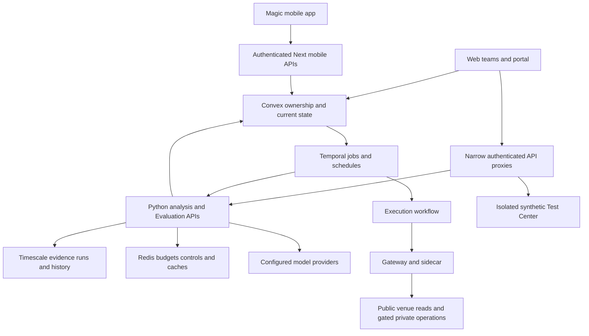

# Current Moeazi capabilities and end to end journeys

Baseline and evidence scope are recorded in the [evidence register](evidence-register.md). **Usable** means concrete reusable code exists in the inspected path; it does not mean this review ran it successfully. **Incomplete** means a partial path exists. **Fixture-only** means synthetic evaluation without product authority. **Missing** means no implementation was found in the scoped active paths; it is not a claim that no similarly named file exists anywhere.

## Current topology

This diagram describes wiring, not verified deployment. The frontend and services can expose an interface while its decisive private operation remains blocked.

## Capability inventory

| Capability | Current classification | Separate gate or limitation | Evidence | Disposition |
| --- | --- | --- | --- | --- |
| Web team creation, drafts, saved versions | Usable | Ownership/configuration validation exists; this audit did not click through UI | L1 | Reuse; Stage 1 |
| Multiple deployments and mode selection | Usable | Funded ownership conflict checks are not complete account risk management | L1–L3 | Reuse and complete identity binding |
| Owner wallets and account linkage | Usable | Particle/Magic root retained; exact runtime delegation must be verified | L6 | Reuse |
| Mobile account provisioning | Incomplete | Creates a draft paused Autopilot profile; selects first matching profile | L4 | Explicit program assignment, Stage 1/7 |
| Mobile funding balance projection | Usable | Fresh RPC observation required; no live balance read in this research | L6 | Reuse freshness/units patterns |
| Fiat on-ramp and sponsored setup | Incomplete | Provider/native/contract certification outstanding; grants no AI session authority | L6 | Qualification gate, Stage 6 |
| Direct mobile USDC withdrawal | Usable | Phone owner-signing and receipt checks implemented; funded certification not established here | L6 | Reuse, add managed-account unwind integration |
| Venue setup workflow | Incomplete | Waits for user proof and externally supplied verification; no automatic certification implied | L7 | Qualify per operation |
| Temporal analysis scheduling | Usable | Manual Guard/Lite defaults constrain runs; legacy poller excluded from normal stack | L2, L11 | Reuse; no new Convex polling |
| Model routing, BYOK, credit budgeting | Usable | Provider compatibility/pricing and configured credentials are runtime prerequisites | L2, L8 | Reuse, cost approval for experiments |
| Structured analyst reports and synthesis | Usable | Confidence/scenario probabilities are heuristics, not calibrated models | L8 | Reuse contracts; evaluate contribution |
| Market observation normalization | Incomplete | Generic HTTP evidence adapter is not a validated numeric feed | L9 | Native/CCXT adapters and observations |
| Evidence citations and grounding | Incomplete | Supplied references overwrite model citations in two paths | L8 | Preserve attribution and add claim checks |
| Quantitative feature/model pipeline | Missing as a complete active workflow | Research fixtures and structured forecasts are not a trained/validated strategy pipeline | L8–L10 | Baselines, Qlib/scikit-learn adapters |
| Strategy proposal construction | Incomplete | Threshold consensus/confidence, capped notional/leverage, empty protective exits | L8 | Versioned strategy runtime |
| Product Shadow | Incomplete | Fresh quote becomes a simple simulated entry; not venue-faithful order replay | L3 | Replace only through versioned opt-in integration |
| Evaluation Lab and customer research | Usable | Frozen experiments/budgets/replays exist; cost accounting and grounding require qualification | L10 | Reuse and extend |
| Synthetic safety proofs | Fixture-only | No production risk, authority, signer, or promotion implied by a pass | L12 | Retain tests; implement real producers separately |
| Account financial journal and reservations | Missing as authoritative live lifecycle | Feature 10 is synthetic; no inspected path supplies complete live financial state | L5, L12 | Bounded custom financial owner |
| Account-wide risk | Incomplete | Execution activity constructs zero exposure/loss/position values | L5 | Ledger-backed risk supervisor |
| Private venue execution | Incomplete | Private methods or sidecar signing unavailable; per-venue gates closed | L5, L7 | Native qualification |
| Fill-confirmed lifecycle and reconciliation | Incomplete | Current reconciliation is too narrow; final proposal status can overstate outcome | L5 | Durable journal and explicit uncertainty |
| Continuous protective management | Missing in inspected execution path | A stop-price helper is not a running position supervisor | L5 | Independent supervisor |
| Managed mobile program releases | Missing | Team versions are reusable, but no complete managed program/cohort/promotion lifecycle | L1, L4 | Versioned releases, Stage 7 |
| Internal Test Center UI and operator Lab | Usable | Still hosted in product frontend; Test Center backend is isolated | L10, L12 | Keep; add connected local console |
| Capacity, recovery, operating cost at 100 accounts | Incomplete | Infrastructure exists; no workload results in this research | L11 | Measure throughout, final Stage 8 gate |

## Journey 1 Web team to customer mode

`agentTeamMutations.create` creates a paused Shadow team and saved version. Draft/save/duplicate flows preserve ownership; duplication resets allocation. `configureMarket` binds a team version to a market/venue/mode and refuses an overlapping funded controller in the inspected check. It leaves the deployment paused.

Temporal's active scheduled-analysis path selects an active deployment, loads its saved model configuration, reserves credits, and carries team/version/deployment identifiers. Analysis stores full history and current projections. Completion derives a proposal; the Convex mutation chooses the deployment mode when present. Shadow records a simulated entry; Approval creates an expiring approval request; Autopilot produces an approved proposal for the execution workflow. Source: [L1–L3](evidence-register.md#local-evidence).

**Gap:** team identity is partly implemented, not absent. Some fallback profile selection and profile-level checks remain. Stage 1 must trace each command through completion, approval, and execution rather than assuming that a team ID on a table completes the migration. Copilot is the user's term; stored `approval_required` and venue `approval` require explicit translation.

## Journey 2 Mobile deposit to withdrawal

Magic signs an authentication challenge on the phone. Bootstrap verifies the owner and creates account/configuration records. Canonical Arbitrum USDC balances determine direct funding readiness; ETH is network-fee funding. Card delivery and sponsored execution are separately gated connector operations. Wallet activation enables wallet execution, not unattended strategy authority.

Mobile start checks a Home projection and changes profile/account activity. It does not itself create a fully verified venue signer. Home currently combines wallet and managed projections; the ledger must later guarantee these do not overlap or double-count transfers. Stop pauses future work and invalidates unsigned mobile preparations, not all existing positions. Direct withdrawal waits behind activity/in-flight execution, prepares an exact USDC transfer, uses phone signing, and verifies the resulting receipt. Sources: [L4, L6](evidence-register.md#local-evidence).

**Gap:** the requested managed experience needs an explicit mobile program assignment, a complete authority/readiness record, position-aware stop, managed collateral repatriation, and a withdrawal coordinator. Preserve working owner-signature and uncertain-send patterns; do not claim the existing direct-wallet withdrawal already performs portfolio unwind.

## Journey 3 Experiment to comparison

Customer Research resolves an owned saved team version. Evaluation v2 freezes selected cases, subjects, stages, routes, prompts, horizons, and budget; preview precedes execution. Evaluation workers record structured outputs and simulated outcomes. The Test Center independently executes allowlisted synthetic safety cases. Sources: [L10, L12](evidence-register.md#local-evidence).

**Gap:** current evaluation is reusable but not a complete shared trading simulator or production release authority. Citation rewriting undermines a grounding metric. Entry/settlement slippage accounting needs a hand-calculated oracle before P&L comparison. The new console should call these backend capabilities through scoped APIs; it should not reproduce them in browser code or a second database.

## Journey 4 Order submission with a lost response

Execution loads the proposal, policy, and account context; rejects expiry, pause, credit exhaustion, and development guard violations; obtains a quote and safety decisions; dispatches and attempts reconciliation. A stable idempotency key is passed. Hyperliquid private operations raise; the sidecar's generic signer remains unavailable. Sources: [L5, L7](evidence-register.md#local-evidence).

**Gap:** retries limited to one are not recovery. The activity eventually calls `transitionTradeProposal(..., status="executed")` without proving a confirmed fill for every gateway outcome. `execute_or_simulate` can also return `simulated` under closed gates. A lost reply needs durable uncertainty, history/order lookup, deduplicated observed fills, and a surviving reservation. This is source-inspected control flow, not a reproduced funded incident.

## Journey 5 Upgrade with open positions

Web team versions and deployment bindings exist. Some edits are restricted while deployments are active. No complete mobile managed-program release, cohort assignment, position-version retention, or automatic compatibility migration was found in the scoped path. Feature 36 promotion and Feature 35 outcome memory are synthetic research only. Sources: [L1, L12](evidence-register.md#local-evidence).

**Gap:** new decisions must use an assigned immutable release while existing positions keep their originating management version. Changing prompts cannot silently replace exits or expand authority. Rollback changes future behavior; it cannot reverse fills.

## Documentation conflicts and operational traps

| Conflict | Resolution for this roadmap |
| --- | --- |
| Guides describe one team per account; code creates multiple teams | Treat multi-team code as current; audit legacy fallbacks and mobile first-profile queries. |
| Some runtime/UI docs mention `/agent-lab`; access guide says root is disabled | Use concrete current routes; do not use a stale root as proof the Test Center is absent. |
| `scheduler.py` contains polling | Compose places old worker/poller paths in legacy profiles; normal scheduling uses Temporal. Do not reintroduce polling based on file discovery. |
| Feature names say authoritative risk/journal/promotion | Inspect producers/consumers: fixture receipts remain non-authorizing. |
| A UI status says running/executed | Derive future truth from assignment/supervisor heartbeat or observed fills, respectively. |
| Gateway health refreshes venue health | This does not populate real exposure, reconciliation, margin, or loss accounting. |
| Signed consensus is meaningful in synthesis; proposal persistence clamps it to 0–1 | Preserve direction separately from agreement strength in new contracts; add bearish-path regression tests. No runtime failure was reproduced here. |

No application behavior was changed to resolve these conflicts. They are tracked work for the staged implementation.
