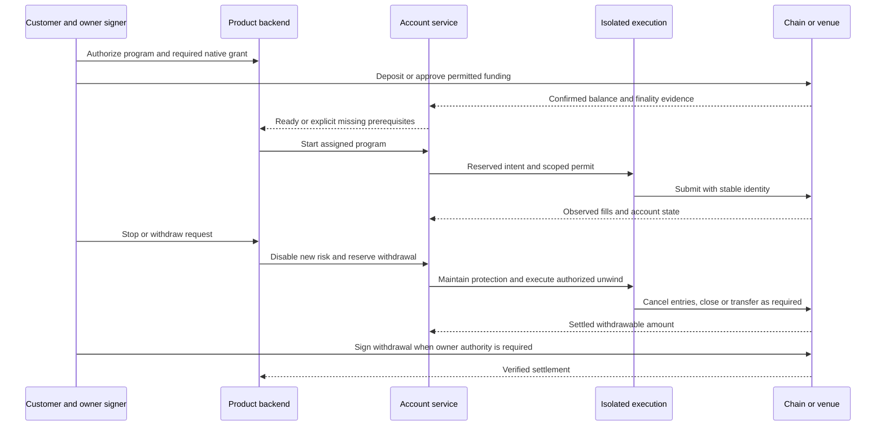

# Execution, funding, and authority qualification

This chapter separates source-visible operations from certified account behavior. None of the venues below was traded, funded, or exercised by this research. A connector name, public quote, setup record, or SDK method does not establish a usable live lifecycle. See [L5–L7](evidence-register.md#local-evidence).

## Current operation coverage

| Venue/path | Public observations or preparation in the inspected normal path | Private lifecycle status | Consequence |
| --- | --- | --- | --- |
| Hyperliquid | Python public mids and account-state adapter; generic quote fields need unit/size clarification | Place, cancel and close methods raise; reconciliation reads positions but is not a complete order/fill recovery protocol | Good native qualification candidate; no current complete autopilot path |
| Uniswap | Trading API quote and TS transaction preparation/validation, including simulation; hosted API dependency remains | Broadcast is gated; production signing/KMS path is unfinished. An AMM swap is not a resting order that supports normal cancellation | Qualify receipt/finality/reorg and token-balance accounting, not exchange-order assumptions |
| GMX | Sidecar public market reads and SDK dependency | Generic execution remains unimplemented/gated; no certified submit/cancel/close/reconcile chain established | Public visibility cannot authorize perpetual exposure |
| Lighter | Routing/setup scaffolding and SDK/connector candidates | Gateway defaults to blocked private adapter in inspected construction | Separate signer, nonce, collateral, order/fill and protection qualification required |
| Orderly | Routing/setup scaffolding | Gateway defaults to blocked private adapter | Account/chain and credential scope must be established operation by operation |
| Ostium | SDK dependency and routing/setup scaffolding | Gateway defaults to blocked private adapter | Dependency installation is not production operation coverage |

The table describes the instantiated gateway/sidecar path, not every experimental module or upstream connector. Test Center capability fixtures remain synthetic. Setup workflows wait for user proof and verification signals; identify and qualify the verifier before treating its signal as evidence of a grant or funded account.

## Native SDK decisions

| Candidate | Evidence and license/version | Boundary and decision | Qualification/rejection |
| --- | --- | --- | --- |
| Hyperliquid Python SDK | MIT, inspected metadata `0.24.0`, revision U7; native API supports agent wallets, client order IDs and order/account reads | **Prototype** behind gateway. Private client belongs exclusively to execution; strategies receive normalized data | Q10: lost acknowledgement, duplicate event, signer nonce contention, reduce-only, partial entry/protection, isolated/cross behavior. Reject any required action that cannot preserve owner custody and stable identity |
| Uniswap SDK packages | Reviewed `@uniswap/v3-sdk` `3.31.5`, MIT, revision U9; router/contracts and transitive packages require separate license/artifact review | **Reuse current quote/prepare boundary; prototype native alternatives only for demonstrated gaps.** SDK is not a signer or transaction lifecycle | Q10: exact chain/router/token amounts, simulation, replacement, receipt and reorg handling. Reject unsupported execution artifacts or mandatory new paid quote service |
| ZeroDev permissions | Reviewed `@zerodev/permissions` `5.6.3`, MIT, revision U8; existing sidecar references Kernel 0.3.3 / EntryPoint 0.7 | **Prototype compatibility**, not a Kernel upgrade. Permission module must match deployed account and owner approval | Q10: allowlisted target/selector/value/token limits, revocation, replay and expiry on exact artifacts. Reject until deployed bytecode/module licensing and compatibility are established |
| Existing GMX/Ostium and other native integrations | Local GMX package declares `@gmx-io/sdk` `1.6.3`; other artifacts and exact licenses are not qualified by this report | **Retain existing boundaries; defer new live selection** pending an operation-level manifest | Q10 applies independently to each venue. An unresolved SDK/dependency license is a gate, not assumed OSS compliance |

Hyperliquid API wallets have signer-specific nonce behavior; queries must use the actual account identity. Reusing a pruned agent address has documented replay implications. Model this in an account-scoped signer service rather than sharing a signing key across unrelated accounts. [Official nonce and API-wallet documentation](https://hyperliquid.gitbook.io/hyperliquid-docs/for-developers/api/nonces-and-api-wallets).

Hyperliquid's native account is not simply an Arbitrum smart-account balance. Bridge/collateral settlement, trading account identity, API-wallet authorization and withdrawal authority are separate facts. Cross margin is documented as the default; a configured leverage value does not continuously cap effective leverage as equity changes. [Margining documentation](https://hyperliquid.gitbook.io/hyperliquid-docs/trading/margining).

Native protective triggers also have fill and lifecycle limitations. Hyperliquid documents mark-price triggers and parent/child behavior that must be tested against partial fills and cancellation; a stop order is not a guaranteed loss bound. Do not interpret a global cancel operation as harmless when it may remove protective orders. [TP/SL documentation](https://hyperliquid.gitbook.io/hyperliquid-docs/trading/take-profit-and-stop-loss-orders-tp-sl).

## Authority has distinct layers

1. **Customer consent:** authenticated participation in a program/policy envelope, withdrawal destination and mode. Convex owns this product record.
2. **Owner authorization:** Particle/Magic signs a specific account activation, grant, transfer or venue approval when required. Never generate a fallback owner key.
3. **Native permission:** a venue agent, smart-account session/module, or explicitly scoped credential grants only the capabilities the native system can enforce.
4. **Moeazi permit:** risk reservation, current consent, policy/version compatibility and live-certification checks bind one intent to one account and permitted operation.
5. **Execution and observation:** isolated signer submits; a separate reconciliation path confirms orders, fills, balances and finality. A successful signature is not settlement.

App-level size limits are not automatically cryptographic limits. Some native API wallets may support broader trading powers than the desired strategy policy. Record this residual authority; bound funded collateral, isolate credentials, enforce application limits, and reject the venue if the approved product mandate requires restrictions the venue cannot enforce. No SDK can make a broad key narrower by labeling it a session key.

Operational delegated credentials, where necessary, are distinct from owner keys. Production storage, encryption, rotation, access control, recovery and revocation must be qualified. Current local key wrapping is not proof of production custody readiness. An external secret manager must satisfy the OSS-only requirement and receive a separate selection review; commercial KMS is not silently selected. LLM/research processes never receive these credentials.

## Deposit to withdrawal lifecycle

This is the destination contract. Current mobile start/stop largely changes profile state; it does not establish this full sequence. Existing receipt-verified withdrawal work is reusable, but a wallet withdrawal cannot withdraw collateral still committed on a venue.

Distinguish `stop_new_entries`, `close_and_stop`, and `withdraw`. Product wording and default stop semantics need an explicit Stage 7 decision. Stopping analyses must not terminate protective supervision. Closing can incur slippage, fees and realized loss; pending/unconfirmed states remain visible. A withdrawal is complete only when its actual destination receipt/finality is verified, not when a workflow dispatches it.

## Native qualification artifact

For each venue/instrument/account type, publish a signed-off capability manifest: supported quote/prepare/sign/submit/amend/cancel/reduce/close/read/fund/withdraw operations; exact package and contract hashes; permission scope; unit and rounding rules; nonce/client-ID behavior; fees/funding; protective limitations; finality/reorg policy; retry classification; rate limits; certification environment and expiry.

Q10 progresses from recorded-response tests, to deterministic local faults, to available venue test environments, and only then explicitly approved funded qualification. Testnet success does not establish mainnet liquidity, permission deployment or settlement equivalence. A venue stays unavailable for any missing critical operation, even if other venues pass.

Execution transport uncertainty means **reconcile before retrying**. Reserve worst-case exposure until authoritative evidence resolves the request. For an AMM, track transaction hash/nonce/replacement and receipt; for an order venue, use venue IDs/client IDs and fills. If the venue cannot resolve identity after an uncertain submission, quarantine the account and escalate rather than inventing a safe retry.

Protective actions must not depend on LLM credits or analysis availability. Gas, native fees and operational reserves are separately budgeted and monitored. Insufficient resources disable new risk and trigger the defined protection/escalation policy; they cannot guarantee the ability to close under all market conditions.
