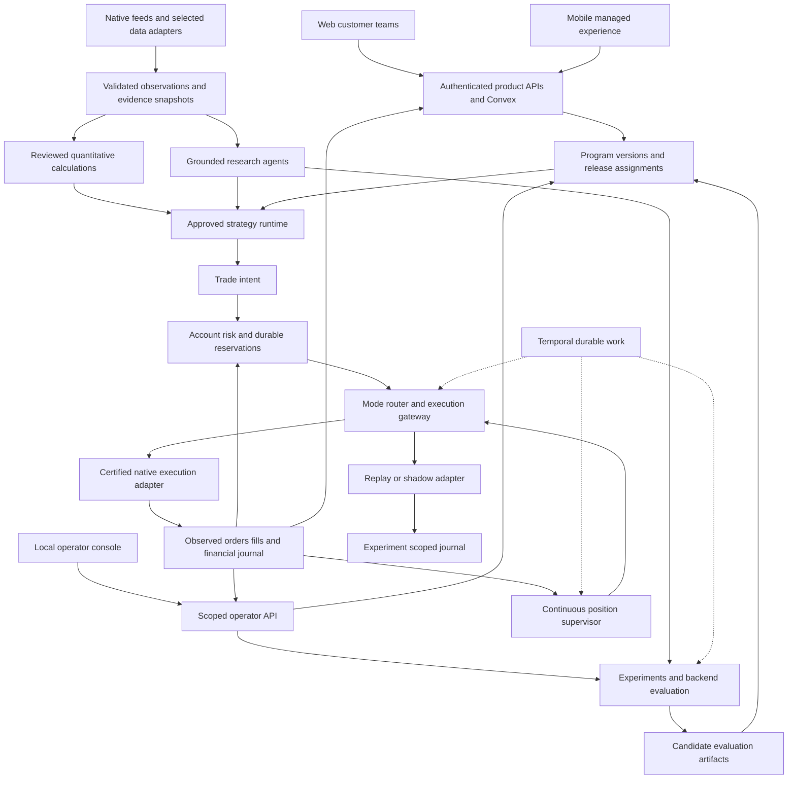
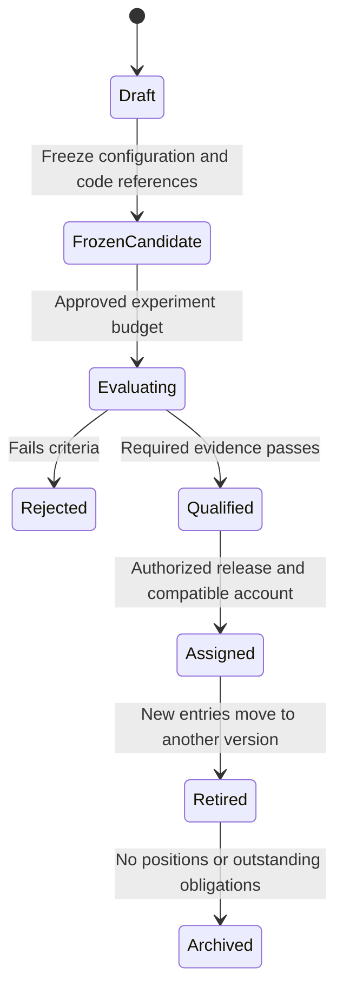

# Target architecture and system ownership

This chapter specifies the recommended destination, not the current runtime. Read [current-system.md](current-system.md) for implemented versus missing behavior. The governing choice is one backend with multiple interfaces and capability-isolated workloads.

## Compare the integration approaches

| Approach | Strength | Cost or conflict | Decision |
| --- | --- | --- | --- |
| Focused libraries and native adapters | Preserves owner wallets, account identities, provider billing, and existing recovery infrastructure; supports incremental migration | Moeazi must implement financial ownership, order journal, supervision, and contract glue | Primary integration approach, limited to explicitly bounded components |
| Embedded trading engine | Can provide event models, replay, order state machines, portfolio calculations, and adapters | Engine persistence, strategy lifecycle, credentials, account semantics, and retries may compete with Moeazi; selected releases/connectors need qualification | Prototype Nautilus for replay first; reconsider hosting a live engine only after the Stage 3 contract tests establish a measurable benefit |
| Research/operator subsystem adoption | Qlib/RD-Agent or Hummingbot/MLflow can supply substantial workflows | May introduce extra databases, credential stores, paid data assumptions, or a second deployment controller | Adopt research computation through adapters; keep operator UI thin and backend-owned authority |

This is not a commitment to hand-build a general trading engine. Reuse validated mathematics, venue protocols, and replay engines. The bounded custom work is the policy and identity integration that must remain specific to Moeazi. A later engine can implement an adapter without becoming a second financial authority.

## Destination topology

An experimental journal uses the same account-state and lifecycle code with a different immutable environment/account namespace. It cannot be selected as a live risk input. Raw model output never flows directly to the signer.

## Responsibility boundaries

| Owner | Inputs and outputs | Persistence and authority | Failure behavior |
| --- | --- | --- | --- |
| Product identity and configuration | Authenticated team/program changes, consent, assignments; current views | Convex remains the authenticated product/configuration owner | Unknown assignment or consent blocks entries; no first-profile fallback |
| Observation service | Venue-specific messages to normalized instruments, events, and snapshots | Timescale evidence/history; Redis bounded hot cache | Sequence gaps, stale time, or unknown units invalidate affected observations |
| Calculation service | Snapshot + reviewed function/version to typed calculation receipt | Reproducible artifact/history in Timescale | Invalid input or unavailable calculation returns explicit failure, not invented values |
| Agent runtime | Bounded evidence and read-only analytical tools to claims/hypotheses | Existing provider routing, credits, usage, and traces | Reject unsupported output or abstain; no signer/credential access |
| Strategy runtime | Frozen strategy/program + snapshot to expiring intent or hold reason | Version binding persists with every decision | No compatible strategy or insufficient evidence means no new risk |
| Financial state owner | Confirmed/uncertain venue events, fills, transfers, valuation references | New ordinary transactional Postgres tables alongside Timescale history; one financial ledger and reservation owner | Drift or unknown settlement retains reservations and blocks new risk; never assume an order failed because a response was lost |
| Risk supervisor | Authoritative financial revision + current policy + intent to exact reservation/permit | Atomic account-scoped Postgres transaction; final configuration checks against Convex revision | Rejection is an ordinary outcome; all teams share the account envelope |
| Mode router | Permitted intent to Shadow, Approval, or Autopilot action | Existing product mode preserved; approval binds exact reviewed intent | Approval expiry or intent changes require revalidation/review, not stale dispatch |
| Gateway/sidecar | Exact permitted intent to native payload and observed outcome | Only boundary allowed to unwrap restricted execution credentials | Unknown outcome enters reconciliation; no generic automatic resend |
| Position supervisor | Open positions, protection, venue observations, expiry and stop requests | Durable Temporal workflow per account/position lifecycle; event processors for timely observations | Continues without LLMs or analysis credits; cannot sign without valid authority |
| Experiment service | Frozen candidate/dataset/protocol/budget to results | Extend existing Evaluation Lab/Timescale/Temporal, separate namespaces and queues | No execution capability; failed and cancelled trials remain visible |
| Program release service | Qualified artifact + requested account cohort to new assignment | Convex current assignment; immutable release evidence in Timescale via reliable publication | No eligibility/compatibility/consent means no assignment change |
| Operator API and console | Verified operator commands and sanitized current/history views | Browser has no worker secret; backend rechecks every operation | Closing console does not affect trading; stale screens cannot issue unbound releases |

Redis never becomes the sole order journal, risk-reservation ledger, or release authority. Temporal owns durable work, not the canonical per-tick market dataset. Convex receives material current projections, not each order-book update. No worker polls Convex for jobs.

## What agents actually do

Agents may extract claims, request deterministic calculations, suggest hypotheses, challenge assumptions, and explain confirmed outcomes. Researchers and challengers exchange typed artifacts with references, not an unbounded transcript treated as authority. Initially permit one challenger revision per research cycle with an explicit budget; this is an experiment bound, not a customer trading rule.

Strategies are approved executable versions. A strategy may consume validated agent features, but an LLM cannot rewrite the live algorithm, size a trade beyond the allocator, waive a gate, or select a wallet capability. An analyst's confidence is a feature to evaluate, not a calibrated probability or authorization token.

Forecast uncertainty, evidence insufficiency, and calculation failure produce explicit abstention. Holding cash is a decision with a recorded reason. Customer reports use ledger facts for amounts/P&L and short evidence-linked explanations; hidden chain-of-thought is never required.

## Runtime and release lifecycles

Qualification is multidimensional: software correctness, strategy evidence, risk envelope, venue/authority certification, and operating capacity. A candidate can pass one dimension and fail another. Program assignment requires all applicable dimensions; no composite score hides a failure.

New entries use the current assignment. Positions keep their origin version and exit policy until closed. Emergency safety reductions apply across versions; rollback cannot restore a known-unsafe permission or undo a fill. Uninstalling code still referenced by a position is blocked. Position migration requires an explicit compatible management plan and revalidation.

## Connected console design

The console has separate views for current programs, candidates, experiments, comparisons, execution/ledger inspection, safety scenarios, and releases. It reads actual backend configuration; if there is no managed mobile assignment yet, it says so instead of relabeling an arbitrary web team as the mobile program.

Use a local browser UI with a narrow authenticated backend-for-frontend if required. Existing backend identity verifies the operator; opaque short-lived, audience-scoped sessions carry read/evaluate/release permissions. Never accept a caller-supplied operator subject or expose `WORKER_SHARED_SECRET` in JavaScript. Localhost binding is defense in depth, not authorization. Preserve origin checks and explicit endpoint allowlists.

Existing customer research, internal Evaluation Lab, and Test Center remain accessible. Their services can be reused without moving their pages. The synthetic Test Center keeps its no-network/no-execution boundary. Real experiment workers and release services have separate capabilities; a synthetic result cannot be converted into production permission.

## Multiaccount operation and cost

Share public observations and reproducible calculations where data rights and scope permit. Do not share account secrets, private evidence, allocations, or journals. Namespace every event and operation by environment/account and bind every funded action to its assigned controller. Prevent multiple strategies independently consuming the same collateral.

For 100 accounts, four watched markets and hourly decisions imply 9,600 account-market evaluations/day before event triggers. Six fresh specialist calls per evaluation imply 57,600 calls/day before synthesis/retries; a 15-minute cadence multiplies this by four. These are arithmetic workload examples, not measured capacity or an agreed deployment profile. Shared public analysis and deterministic account evaluation can reduce repeated calls, but contribution must be measured rather than assuming every account needs a unique committee every interval.

Use separate concurrency budgets for research, new entries, and protective work. Reserve monitoring/exit resources outside customer AI credits. A shared dependency failure can affect every account; include simultaneous-exit load and provider/venue rate limits in Stage 8, not just nominal account count.

## Migration policy

All stages are additive behind explicit version/enabling controls. Add new contracts/tables/endpoints without silently changing legacy semantics. Historical records missing team/program identity remain `legacy_unresolved` until an unambiguous binding can be established. Never backfill guessed identities.

A production migration reconciles account state, checks authority, freezes new entries briefly where necessary, publishes the assignment, and records the compatibility decision. Old interfaces remain. Their later removal would need a separately approved migration and demonstrated replacement; it is not part of this roadmap's completion criteria.
