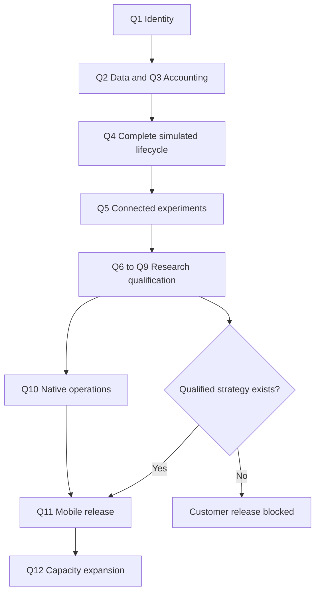

# Qualification, readiness, and unresolved gates

The research deliverable is complete when the linked map, decisions and stage briefs are internally consistent. The system is not thereby complete. All qualification experiments below are **not run in this research**. No fixture, source inspection or documentation claim may be relabeled as observed live behavior.

## Evidence and decision rules

Use `documented`, `source_inspected`, `local_fixture`, `recorded_replay`, `forward_shadow`, `test_environment_observed`, and `funded_observed` as distinct evidence origins. Every result carries code/configuration/data hashes, environment, account/instrument scope, timestamps and limitations.

Gate results are `pass`, `fail`, `inconclusive`, or `not_run`. A pass includes the declared acceptance criteria and actual measurements. A changed relevant dependency, policy, dataset, permission or execution artifact invalidates affected conclusions. A passing interface test cannot attest strategy profit or real signing capability.

Freeze metrics, tolerances, failure definitions, sample design and resource caps before qualification. Structural safety checks (tenant isolation, no unreserved dispatch, no duplicate logical posting, stable order identity, forbidden credential access) permit no known violations. Economic, statistical and latency thresholds require an explicitly owned, preregistered decision; this report does not invent universal safe limits.

## Qualification register

| ID / stage | Experiment and required artifact | Pass/rejection and fallback |
| --- | --- | --- |
| Q1 / 1 | Multi-user/team/mode and mobile-assignment traces; frozen-version and old-payload compatibility; actor-scope tests | Pass only with explicit identity/authority throughout. Reject first-profile inference and cross-tenant access; preserve unresolved legacy accounts paused |
| Q2 / 2 | Recorded native/CCXT payload corpus with schema/time/unit/sequence/finality faults; snapshot replay; optional Pandera/DuckDB/OpenBB comparison | Required fields/rights/time semantics established, defects rejected, identical accepted snapshots. Reject adapter assumptions; keep native/Pydantic/SQL baseline |
| Q3 / 2 | Hand-calculated ledger and risk oracle, concurrent reservation/withdrawal races, crash/outbox/fencing tests | Exact journal totals and no over-reservation; unknown state blocks new risk. Reject Redis-only locks or placeholder financial inputs |
| Q4 / 3 | Lifecycle fault suite and simulator comparison for spot/perps, partial fills, uncertain submission, funding, costs, protection and restart | Correct state transitions and oracle agreement within declared decimal/valuation rules. Reject engine parity claims for unsupported mechanics; retain narrow custom oracle/contracts |
| Q5 / 4 | Real backend experiment created in console, A/B replay/export, auth/cancel/restart, Hummingbot/MLflow value comparison | Reproducible backend lineage and isolation; no duplicate authority or secrets. Reject imported operator stack that requires conflicting owners; retain thin console |
| Q6 / 5 | Chronological baseline/ML/agent strategy comparison, frozen holdout, leakage probes, costs/turnover sensitivity, complete search ledger | Meet preregistered out-of-sample economic/risk criteria with uncertainty. Reject unhelpful Qlib/Optuna/model complexity; no qualified strategy is a valid research result but blocks launch |
| Q7 / 5 | Ground-truth claim corpus with supported/unsupported/stale/irrelevant/adversarial cases; numeric receipts, ablation and abstention calibration; compare existing judge/Ragas | Meet preregistered false-acceptance, numerical correctness and selective-performance targets. Reject citation overwrite and judge-only truth; reduce model authority or abstain |
| Q8 / 5 | Offline RD-Agent sandbox with allowlisted data/tools, resource/egress tests, provider-routing budget adapter and reproducible artifacts | No credential/customer/live access or uncontrolled calls; useful reproducible hypotheses. Reject unsafe integration; keep human/ordinary-agent proposals |
| Q9 / 5 | Simple allocator versus CVXPY/optional PyPortfolioOpt under rounding, correlated exposures, scarce collateral, infeasible/timeout cases | Hard constraints hold after rounding and solution adds measured benefit. Reject solver failures/extra complexity; retain deterministic allocator |
| Q10 / 6 | Per-venue capability manifest, exact SDK/contract/grant scope, native order/fill/collateral/withdrawal faults and separately approved funded observations | Critical operations and authority/recovery pass independently; unsupported venue remains disabled. Test environment cannot certify mainnet equivalence |
| Q11 / 7 | End-to-end mobile enrollment/funding/start/stop/withdrawal; truthful report; operator release and open-position upgrade/rollback | Assignment/consent/readiness match actual state; no abandoned exposure or funds. Reject incompatible upgrade; retain old supervisor or drain before migration |
| Q12 / 8 | 10/50/100-account isolated workload, noisy neighbor, failover/restore and cost measurement | Meets declared SLO/cost/capacity envelope with financial invariants intact. Reject expansion; throttle/cohort within demonstrated limits |

## Dependency gates

Q8/Q9 may close with a documented rejection/defer decision if their optional tool is not used. Their security/constraint principles still apply. Q6 must produce a qualifying strategy before customer release. Q10 funded work always requires separate authorization. Independent reading and offline adapter work can proceed while other gates are blocked; dependent activation cannot.

## Operational readiness by lifecycle

| Point | Required proof before proceeding | Failure behavior |
| --- | --- | --- |
| Observe | Valid identity, time/units/freshness/finality and rights | Reject/quarantine data, show unknown |
| Decide | Qualified artifact, available evidence, valid calculation/claim envelope | Abstain or use explicitly qualified deterministic fallback |
| Reserve | Reconciled balances/exposure, account-wide limits, current policy and consent | Deny new risk; keep existing reservations |
| Dispatch | Current grant/certificate/epoch, stable key, required simulation/permit | Fail closed; no generic simulated-success substitution |
| Reconcile | Orders/fills/native settlement evidence and dedupe | Keep uncertain exposure reserved, quarantine and escalate |
| Protect | Confirmed position ownership and protective capability, independent resources | Follow venue-specific degraded policy; surface gaps rather than promise loss bounds |
| Release | Frozen qualification evidence, operator scope, consent compatibility and position plan | Reject or stage/drain; no arbitrary replacement of active positions |
| Withdraw | Available settled funds after reservations/unwind, approved destination and required owner signature | Pending/failed reason; no success until observed settlement |
| Restore | Current authoritative observations and fenced writer ownership | Read-only/protection recovery before new entries |

## Unresolved decision and gap register

These are explicit gates, not hidden assumptions. Owners name roles to be assigned during implementation.

| Gap | Owner and resolution | Stage/blocking effect |
| --- | --- | --- |
| G1 First launch venue, instrument universe and cadence | Product + trading engineering compare complete native operations, liquidity/data costs, authority and eligibility | Research can compare candidates; blocks funded strategy/native release selection |
| G2 Production delegated-secret storage and native grant compatibility | Execution/security owner selects OSS-compatible storage/rotation/recovery and exact deployed permission artifacts | Blocks Q10 live certificate; no owner-key fallback or automatic commercial KMS selection |
| G3 Strategy validity and approved risk limits | Quant + product/risk owner preregister net performance, exposure, loss, leverage, liquidity and stop criteria; validate holdout/shadow | No strategy or “safe” numerical limit proven; blocks Q11 customer release |
| G4 Historical data availability, fidelity and rights | Data owner acquires permitted event/funding/fee histories with decision-time cutoffs and retention | Blocks results requiring unavailable history; candle-only simulation cannot establish book/AMM realism |
| G5 Existing mobile account/team mapping | Product/backend owner audits ambiguity and records explicit assignment/consent | Blocks start for unresolved accounts; do not select first profile |
| G6 Stop semantics and consent envelope | Product owner defines pause versus close-and-stop/withdraw wording and allowed program changes | Blocks final mobile activation/upgrade behavior |
| G7 Financial bootstrap and reconciliation | Financial-service owner produces opening-balance provenance and clears discrepancies | Blocks new funded risk for unreconciled accounts |
| G8 Complete transitive OSS manifests and stable versions | Integration owner pins packages/images/contracts and reviews required/optional proprietary dependencies | Blocks installation/adoption of unqualified artifacts; reviewed HEAD is not a runtime pin |
| G9 Capacity/SLO/budget targets | Operations owner declares workload/latency/recovery/error budgets and validates measurements | Blocks expansion beyond measured cohort; no infrastructure-cost estimate is asserted now |
| G10 Native operation and venue verifier completeness | Execution owner identifies trusted proof source and demonstrates all required lifecycle operations | Blocks private execution where an external verification signal or unsupported operation is unresolved |
| G11 Product eligibility and funded operating readiness | Product/operations owners confirm supported customer/venue/account conditions and incident responsibilities | Explicit launch gate; this report makes no jurisdictional or regulatory determination |
| G12 LLM historical contamination and judge reliability | Research owner measures forward-shadow behavior and independent claim labels; documents model training-cutoff limits | Historical LLM backtests alone cannot establish a tradable edge |

## Cost authorization and execution policy

This research initiated no deployment, CI job, model call, funded transaction or billable provider experiment. Future briefs prefer local fixtures and recorded payloads. Before any potentially metered action, identify the service, estimate cost/usage or explicitly state it is unknown, and obtain approval for that action. A prior request to implement or test is not sufficient authorization under the repository rule.

Cost previews include model input/output/retries/judges, trial count, market data, RPC/on-ramp requests, storage/retention, infrastructure, gas/bridges, venue fees/funding and potential funded-test loss where applicable. Unknown variable cost must be bounded operationally before an approved run where possible; do not silently spend to resolve uncertainty.

## Earlier experiment mapping

| Earlier register | Current gate | Revised scope |
| --- | --- | --- |
| V0 grounding correction | Q7 | Both normal orchestration and Lab attribution, plus independent claim labels |
| V1 market-data qualification | Q2 | Instrument/time/finality/rights and backend replay ownership |
| V2 execution-engine qualification | Q4 | Shared account lifecycle and crash recovery before engine selection |
| V3 quantitative strategies | Q6 | Full program/holdout/cost lineage and managed-mobile eligibility |
| V4 agent-assisted discovery | Q8 | Sandboxed discovery with existing provider routing |
| V5 portfolio optimization | Q9 | Simple allocator baseline and exact post-rounding constraints |
| V6 execution and account risk | Q3/Q4/Q10 | Split ledger/reservations, simulated lifecycle, and native certification |
| V7 evaluation and learning | Q7/Q6 | Agent contribution, calibration and outcome provenance |
| V8 operations | Q12 | Shared-data economics, protection priority and 10–100-account recovery |

See the preserved [original validation roadmap](../agentic-trading/validation-roadmap.md). The new scope explains recommendation changes; it does not retroactively claim those earlier experiments passed.
